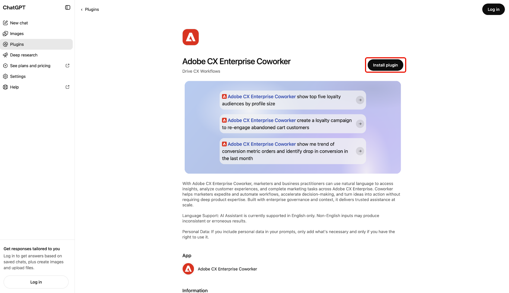

# AI 플랫폼용 Adobe CX Enterprise Coworker

AI 플랫폼용 Adobe CX Enterprise Coworker을 사용하여 이미 사용 중인 AI 도구에서 마케팅 인사이트를 얻을 수 있습니다. 도구를 전환하지 않고 자연어로 질문할 수 있습니다. 각 플랫폼에서 Adobe CX Enterprise Coworker으로 나열된 제품을 찾습니다.

[Coworker 설정](#set-up-coworker)에서 사용 가능한 플랫폼과 설정 지침을 찾으십시오.

AI 플랫폼에서 Coworker를 사용하는 데 드는 추가 비용이 없습니다. CX Enterprise Coworker 라이선스에 포함되어 있으며 다른 동료 기능과 동일한 AI 크레딧에서 사용이 파생됩니다. 자세한 내용은 [Adobe Experience Platform 에이전트 작업 및 AI 크레딧 사용량](https://experienceleague.adobe.com/ko/docs/cx-enterprise-ai/experience-cloud-ai/overview/ai-credit-consumption){target="_blank"}을 참조하십시오.

<!-- TODO: architecture diagram pending from engineering. KT page notes "to be provided on 8/28"; still outstanding as of 8/31. Insert here once received. -->

## 사전 요구 사항 {#prerequisites}

AI 플랫폼에서 Coworker를 사용하기 전에 다음 사항을 확인하십시오.

* Adobe CX Enterprise Coworker은 조직에 대해 프로비저닝되었으며, Adobe에서 해당 조직에 대한 자체 액세스 권한이 있습니다.
* Adobe Experience Platform 및 Adobe Real-Time CDP, Adobe Journey Optimizer 또는 Adobe Customer Journey Analytics 중 하나 이상.
* [Coworker 설정](#set-up-coworker)에 나열된 AI 플랫폼에 액세스합니다.

## 데이터 액세스 및 권한 {#data-access-and-permissions}

AI 플랫폼의 동료는 Adobe ID에 연결된 동일한 데이터 및 액세스 수준을 반영합니다. 쿼리하고 볼 수 있는 내용은 Experience Platform 및 관련 솔루션에서 이미 권한이 부여된 항목과 일치합니다. Coworker는 이러한 권한을 상속하므로 AI 플랫폼 통합에 별도의 권한 설정이 필요하지 않습니다. 동료는 읽기 전용 인사이트를 반환하고 고객 데이터를 수정하지 않습니다. 생성된 요약 및 분석을 사용하여 비즈니스 결정을 내리기 전에 검토하십시오.

<!-- Confirmed by PM (Siddhartha Srivastava) on 2026-09-02 for Microsoft 365 Copilot, Claude, and ChatGPT. Validate this permissions model for each additional platform before adding its setup tab. -->

## 주요 사용 사례 {#key-use-cases}

AI 플랫폼의 Coworker를 사용하여 일상적인 도구를 종료하지 않고 일반적인 마케팅 워크플로우를 가속화할 수 있습니다.

| 사용 사례 | 설명 |
| --- | --- |
| 캠페인 계획 및 검토 | 파트너 캠페인 검토 및 대상 예측을 포함한 캠페인을 계획합니다. 시간 경과에 따른 캠페인 성과를 비교하고 전환을 유도하는 접점을 식별합니다. |
| 여정 및 캠페인 준비 모니터링 | 활성 캠페인을 검토 및 모니터링하고, 고객 여정을 분석하고, 캠페인 준비도를 평가합니다. 여정 성능 및 드롭오프를 추적하여 최적화할 수 있는 기회를 정확하게 찾아냅니다. |
| 운영 인사이트 검색 | 어디에 노력을 집중해야 할지 우선 순위를 지정할 수 있도록 가장 규모가 크거나 가장 많이 참여하는 대상을 식별하고, 시간이 지남에 따라 세그먼트가 어떻게 증가하거나 축소되는지 추적합니다. |
| 워크플로우 및 콘텐츠 최적화 | CX 캠페인에 대한 워크플로우를 최적화하고 에셋 및 콘텐츠 요구 사항을 파악합니다. 쿼리나 대시보드를 수동으로 작성하지 않고도 캠페인 성능에 대한 시각적 보고서를 생성할 수 있습니다. |
| 신속한 공동 작업 및 결정 | 추천 프롬프트를 사용하여 대상자, 캠페인 및 웹 트래픽을 탐색합니다. 계획 회의 중에 팀과 통찰력을 공유하고, 계획 또는 데크를 검토하는 동안 즉석 질문에 실시간으로 답변할 수 있습니다. |

<!-- Use cases approved by PM Siddhartha Srivastava on 2026-08-31 and confirmed for Microsoft 365 Copilot, Claude, and ChatGPT on 2026-09-02. Validate applicability for each additional platform before adding its setup tab. -->

## 동료 설정 {#set-up-coworker}

설치 지침에 사용할 수 있는 플랫폼을 선택합니다. 설정 후 [예제 프롬프트](#example-prompts)를 시도해 보십시오.

>[!BEGINTABS]

>[!TAB Microsoft 365 Copilot]

[!DNL Microsoft 365 Copilot]에서 마케팅 인사이트를 얻으려면 [!DNL Adobe CX Enterprise Coworker for Copilot]을(를) 사용하십시오.

시작하기 전에 [!DNL Microsoft 365 Copilot]에 대한 액세스 권한이 있는지 확인하십시오.

**조직에 대한 동료 설정**

최종 사용자가 [!DNL Microsoft 365 Copilot]에서 Coworker에 액세스하려면 관리자가 이러한 단계를 완료해야 합니다.

1. [!DNL Microsoft 365 admin center]에서 테넌트 설정이 외부 게시자가 만든 앱과 에이전트를 허용하는지 확인합니다.
1. [!DNL Microsoft 365 admin center] 및 [!DNL Teams admin center]에서 **[!UICONTROL Adobe CX Enterprise Coworker]**&#x200B;을(를) 승인합니다. 일반적으로 [!DNL Microsoft Commercial Marketplace] 또는 조직의 **[!UICONTROL 통합 앱]** 목록을 통해 에이전트를 찾을 수 있습니다.
1. 최종 사용자에게 에이전트를 배포합니다. 특정 사용자 또는 그룹 또는 전체 조직에 배포할 수 있습니다. 활성화한 사용자 수는 설정 또는 비용에 영향을 주지 않습니다.

>[!NOTE]
>
>[!DNL Microsoft]에서 새 권한이 필요한 Coworker 업데이트를 릴리스하는 경우 관리자는 [!DNL Agent Registry]에서 업데이트를 승인해야 사용자에게 롤아웃됩니다.

[!DNL Copilot]**에서**&#x200B;동료에 액세스

관리자가 Coworker를 사용하도록 설정하면 [!DNL Teams], [!DNL Word], [!DNL Excel], [!DNL PowerPoint] 및 웹 채팅을 포함하여 [!DNL Microsoft 365 Copilot] 표면에 액세스할 수 있습니다.

[!DNL Microsoft 365 Copilot]에서 **[!UICONTROL 에이전트]**&#x200B;를 선택한 다음 **[!UICONTROL 추가 에이전트]**&#x200B;를 선택합니다.

그런 다음 에이전트 카탈로그에서 **[!UICONTROL Adobe CX Enterprise Coworker]**&#x200B;을(를) 선택합니다.

마지막으로 **[!UICONTROL 추가]**&#x200B;를 선택하여 에이전트에 Coworker를 추가합니다.

추가 단추가 강조 표시된 Microsoft 365 Copilot의 

>[!TAB ChatGPT]

[!DNL ChatGPT]에서 마케팅 인사이트를 얻으려면 [!DNL Adobe CX Enterprise Coworker for ChatGPT]을(를) 사용하십시오.

시작하기 전에 [!DNL ChatGPT]에 대한 액세스 권한이 있는지 확인하십시오.

**조직에 대한 동료 설정**

* 선택한 사용자 또는 전체 조직에 대해 **[!UICONTROL Adobe CX Enterprise Coworker]**&#x200B;을(를) 승인하도록 [!DNL ChatGPT] 관리자에게 요청하십시오.

[!DNL ChatGPT]**에서**&#x200B;동료에 액세스

[!DNL ChatGPT]에서 **[!UICONTROL 플러그인]**&#x200B;을 선택합니다.

그런 다음 플러그 인 카탈로그에서 **[!UICONTROL Adobe CX Enterprise Coworker]**&#x200B;을(를) 찾아 선택합니다.

마지막으로 **[!UICONTROL 플러그 인 설치]**&#x200B;를 선택하여 [!DNL ChatGPT]에 Coworker를 추가합니다.

>[!TAB 클라우드]

[!DNL Claude]에서 Coworker를 사용하여 마케팅 인사이트를 얻으십시오.

시작하기 전에 [!DNL Claude]에 대한 액세스 권한이 있는지 확인하십시오.

**조직에 대한 동료 설정**

* 선택한 사용자 또는 전체 조직에 대해 **[!UICONTROL Adobe CX Enterprise Coworker]**&#x200B;을(를) 승인하도록 [!DNL Claude] 관리자에게 요청하십시오.

[!DNL Claude]**에서**&#x200B;동료에 액세스

1. [!DNL Claude]에서 **[!UICONTROL 사용자 지정]**&#x200B;을 선택합니다.

   

1. **[!UICONTROL 커넥터]**&#x200B;를 선택한 다음 **[!UICONTROL 검색]**&#x200B;을 선택하고 **[!UICONTROL 검색]**&#x200B;을 사용하여 Adobe CX Enterprise Coworker을 찾습니다.

   

1. **[!UICONTROL Adobe CX Enterprise Coworker]**&#x200B;을 선택한 다음 **[!UICONTROL 클라우드에 연결]**&#x200B;을 선택합니다.

   

1. Coworker를 [!DNL Claude]에 연결하려면 Adobe 자격 증명으로 로그인하십시오.

>[!ENDTABS]

<!-- Setup steps above reflect the real customer-facing flow confirmed by PM (Siddhartha Srivastava) on 2026-09-02: an org admin approves the connector or plugin, then end users find and add it in their platform's catalog and sign in. The previous version of this file described a manual MCP-connector setup for ChatGPT (Settings > Connectors > paste server URL) -- PM clarified that flow is for internal testing only, not the customer path, so it was removed here. -->

## 프롬프트 예 {#example-prompts}

지원되는 플랫폼에서 Coworker를 설정한 후 이러한 프롬프트를 시도하거나 자연어로 직접 작성하십시오.

* 상위 5명의 대상자를 표시합니다.
* 지난 달에 대한 지표를 표시합니다.
* 활성 Workfront 프로젝트를 표시합니다.
* 충성도 대상자와 함께 여정을 표시합니다.

## 알려진 제한 사항 {#known-limitations}

AI 플랫폼의 동료가 모든 통합 패턴을 지원하는 것은 아닙니다.

* Coworker를 MCP를 사용하여 자신의 에이전트 하네스에 연결할 수 없습니다.

## AI 플랫폼의 Coworker 문제 해결 {#troubleshoot}

AI 플랫폼에서 Coworker를 사용하여 문제가 발생하는 경우 다음 단계를 수행하십시오.

* 오류가 표시되면 로그아웃한 후 Adobe 자격 증명으로 다시 로그인합니다. 재인증은 대부분의 문제를 해결합니다.
* 동료나 특정 데이터에 액세스할 수 없는 경우 Adobe 관리자에게 문의하여 제품 액세스 및 권한을 확인하십시오.

<!--
Editorial maintenance, 2026-10-27:
Only approved platforms with validated setup guidance belong in the rendered tab set.
Remaining platforms to add: Gemini, Amazon Quick, IBM, and Databricks.

To add an approved platform:
* Confirm approval and obtain access to the customer flow.
* Validate prerequisites, organization approval, catalog discovery, listing name, installation, and Adobe sign-in.
* Confirm the shared licensing, permissions, use cases, prompts, limitations, and troubleshooting guidance applies.
* Add one tab before ENDTABS, following the existing order: introduction, platform prerequisites, organization setup, and user access.
* Document any platform-specific requirements or exceptions within that tab.
* Preview the tab and verify its links and image references.
Keep the introduction, metadata, and shared prerequisites free of platform lists so adding a tab does not require duplicate updates.

Gemini draft scope:
No setup steps are confirmed. Validate the complete customer flow and all shared guidance before adding the tab.
Do not infer the flow from another platform.
-->
