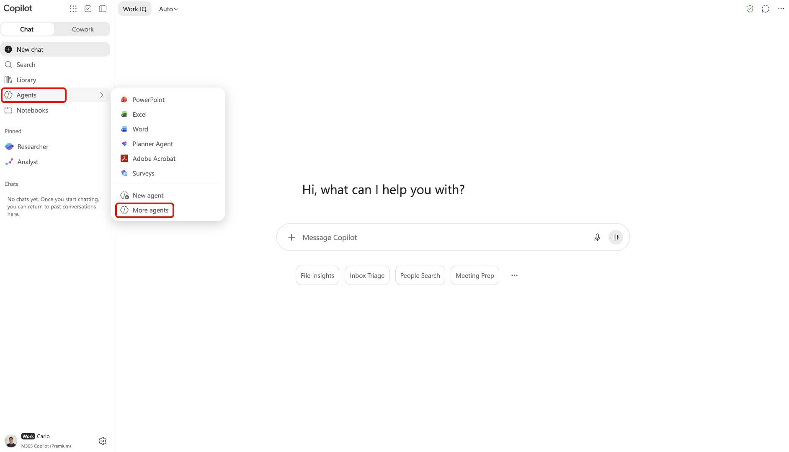
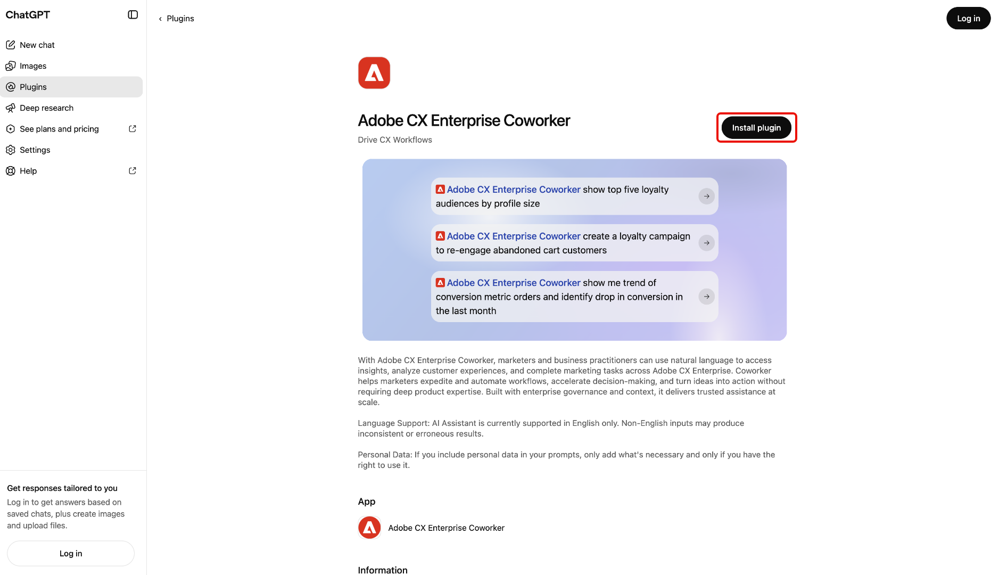

# AI 플랫폼용 Adobe CX Enterprise Coworker

AI 플랫폼용 Adobe CX Enterprise Coworker을 사용하여 이미 사용 중인 AI 도구에서 마케팅 인사이트를 얻을 수 있습니다. 도구를 전환하지 않고 자연어로 질문할 수 있습니다. 각 플랫폼에서 Adobe CX Enterprise Coworker으로 나열된 제품을 찾습니다.

[Coworker 설정](#set-up-coworker)에서 사용 가능한 플랫폼과 설정 지침을 찾으십시오.

AI 플랫폼에서 Coworker를 사용하는 데 드는 추가 비용이 없습니다. CX Enterprise Coworker 라이선스에 포함되어 있으며 다른 동료 기능과 동일한 AI 크레딧에서 사용이 파생됩니다. 자세한 내용은 [Adobe Experience Platform 에이전트 작업 및 AI 크레딧 사용량](https://experienceleague.adobe.com/ko/docs/cx-enterprise-ai/experience-cloud-ai/overview/ai-credit-consumption){target="_blank"}을 참조하십시오.

<!-- TODO: architecture diagram pending from engineering. KT page notes "to be provided on 8/28"; still outstanding as of 8/31. Insert here once received. -->

## 사전 요구 사항 {#prerequisites}

AI 플랫폼에서 Coworker를 사용하기 전에 다음 사항을 확인하십시오.

* Adobe CX Enterprise Coworker은 조직에 대해 프로비저닝되었으며, Adobe에서 해당 조직에 대한 자체 액세스 권한이 있습니다.
* Adobe Experience Platform 및 Adobe Real-Time CDP, Adobe Journey Optimizer 또는 Adobe Customer Journey Analytics 중 하나 이상.
* [Coworker 설정](#set-up-coworker)에 나열된 AI 플랫폼에 액세스합니다.

## 데이터 액세스 및 권한 {#data-access-and-permissions}

AI 플랫폼의 동료는 Adobe ID에 연결된 동일한 데이터 및 액세스 수준을 반영합니다. 쿼리하고 볼 수 있는 내용은 Experience Platform 및 관련 솔루션에서 이미 권한이 부여된 항목과 일치합니다. Coworker는 이러한 권한을 상속하므로 AI 플랫폼 통합에 별도의 권한 설정이 필요하지 않습니다. 동료는 읽기 전용 인사이트를 반환하고 고객 데이터를 수정하지 않습니다. 생성된 요약 및 분석을 사용하여 비즈니스 결정을 내리기 전에 검토하십시오.

<!-- Confirmed by PM (Siddhartha Srivastava) on 2026-09-02 for Microsoft 365 Copilot, Claude, and ChatGPT. Validate this permissions model for each additional platform before adding its setup section. -->

## 주요 사용 사례 {#key-use-cases}

AI 플랫폼의 Coworker를 사용하여 일상적인 도구를 종료하지 않고 일반적인 마케팅 워크플로우를 가속화할 수 있습니다.

| 사용 사례 | 설명 |
| --- | --- |
| 캠페인 계획 및 검토 | 파트너 캠페인 검토 및 대상 예측을 포함한 캠페인을 계획합니다. 시간 경과에 따른 캠페인 성과를 비교하고 전환을 유도하는 접점을 식별합니다. |
| 여정 및 캠페인 준비 모니터링 | 활성 캠페인을 검토 및 모니터링하고, 고객 여정을 분석하고, 캠페인 준비도를 평가합니다. 여정 성능 및 드롭오프를 추적하여 최적화할 수 있는 기회를 정확하게 찾아냅니다. |
| 운영 인사이트 검색 | 어디에 노력을 집중해야 할지 우선 순위를 지정할 수 있도록 가장 규모가 크거나 가장 많이 참여하는 대상을 식별하고, 시간이 지남에 따라 세그먼트가 어떻게 증가하거나 축소되는지 추적합니다. |
| 워크플로우 및 콘텐츠 최적화 | CX 캠페인에 대한 워크플로우를 최적화하고 에셋 및 콘텐츠 요구 사항을 파악합니다. 쿼리나 대시보드를 수동으로 작성하지 않고도 캠페인 성능에 대한 시각적 보고서를 생성할 수 있습니다. |
| 신속한 공동 작업 및 결정 | 추천 프롬프트를 사용하여 대상자, 캠페인 및 웹 트래픽을 탐색합니다. 계획 회의 중에 팀과 통찰력을 공유하고, 계획 또는 데크를 검토하는 동안 즉석 질문에 실시간으로 답변할 수 있습니다. |

<!-- Use cases approved by PM Siddhartha Srivastava on 2026-08-31 and confirmed for Microsoft 365 Copilot, Claude, and ChatGPT on 2026-09-02. Validate applicability for each additional platform before adding its setup section. -->

## 동료 설정 {#set-up-coworker}

설치 지침에 사용할 수 있는 플랫폼을 선택합니다. 설정 후 [예제 프롬프트](#example-prompts)를 시도해 보십시오.

* [Microsoft 365 부조종사](#microsoft-365-copilot)
* [ChatGPT](#chatgpt)
* [클로드](#claude)
* [제미니 엔터프라이즈](#gemini-enterprise)
* [Amazon 빠른](#amazon-quick)
* [IBM watsonx 오케스트레이션](#ibm-watsonx-orchestrate)
* [Databricks](#databricks)

### [!DNL Microsoft 365 Copilot] {#microsoft-365-copilot}

[!DNL Microsoft 365 Copilot]에서 마케팅 인사이트를 얻으려면 [!DNL Adobe CX Enterprise Coworker for Copilot]을(를) 사용하십시오.

시작하기 전에 [!DNL Microsoft 365 Copilot]에 대한 액세스 권한이 있는지 확인하십시오.

#### 조직 액세스 설정 {#copilot-organization-setup}

최종 사용자가 [!DNL Microsoft 365 Copilot]에서 Coworker에 액세스하려면 관리자가 이러한 단계를 완료해야 합니다.

1. [!DNL Microsoft 365 admin center]에서 테넌트 설정이 외부 게시자가 만든 앱과 에이전트를 허용하는지 확인합니다.
1. [!DNL Microsoft 365 admin center] 및 [!DNL Teams admin center]에서 **[!UICONTROL Adobe CX Enterprise Coworker]**&#x200B;을(를) 승인합니다. 일반적으로 [!DNL Microsoft Commercial Marketplace] 또는 조직의 **[!UICONTROL 통합 앱]** 목록을 통해 에이전트를 찾을 수 있습니다.
1. 최종 사용자에게 에이전트를 배포합니다. 특정 사용자 또는 그룹 또는 전체 조직에 배포할 수 있습니다. 활성화한 사용자 수는 설정 또는 비용에 영향을 주지 않습니다.

>[!NOTE]
>
>[!DNL Microsoft]에서 새 권한이 필요한 Coworker 업데이트를 릴리스하는 경우 관리자는 [!DNL Agent Registry]에서 업데이트를 승인해야 사용자에게 롤아웃됩니다.

#### 동료 액세스 {#copilot-access}

관리자가 Coworker를 사용하도록 설정하면 [!DNL Teams], [!DNL Word], [!DNL Excel], [!DNL PowerPoint] 및 웹 채팅을 포함하여 [!DNL Microsoft 365 Copilot] 표면에 액세스할 수 있습니다.

[!DNL Microsoft 365 Copilot]에서 **[!UICONTROL 에이전트]**&#x200B;를 선택한 다음 **[!UICONTROL 추가 에이전트]**&#x200B;를 선택합니다.

그런 다음 에이전트 카탈로그에서 **[!UICONTROL Adobe CX Enterprise Coworker]**&#x200B;을(를) 선택합니다.

마지막으로 **[!UICONTROL 추가]**&#x200B;를 선택하여 에이전트에 Coworker를 추가합니다.

추가 단추가 강조 표시된 Microsoft 365 Copilot의 

### [!DNL ChatGPT] {#chatgpt}

[!DNL ChatGPT]에서 마케팅 인사이트를 얻으려면 [!DNL Adobe CX Enterprise Coworker for ChatGPT]을(를) 사용하십시오.

시작하기 전에 [!DNL ChatGPT]에 대한 액세스 권한이 있는지 확인하십시오.

#### 조직 액세스 설정 {#chatgpt-organization-setup}

추가하기 전에 관리자가 동료의 동의를 받아야 합니다.

* 선택한 사용자 또는 전체 조직에 대해 **[!UICONTROL Adobe CX Enterprise Coworker]**&#x200B;을(를) 승인하도록 [!DNL ChatGPT] 관리자에게 요청하십시오.

#### 동료 액세스 {#chatgpt-access}

[!DNL ChatGPT]에서 **[!UICONTROL 플러그인]**&#x200B;을 선택합니다.

그런 다음 플러그 인 카탈로그에서 **[!UICONTROL Adobe CX Enterprise Coworker]**&#x200B;을(를) 찾아 선택합니다.

마지막으로 **[!UICONTROL 플러그 인 설치]**&#x200B;를 선택하여 [!DNL ChatGPT]에 Coworker를 추가합니다.

### [!DNL Claude] {#claude}

[!DNL Claude]에서 Coworker를 사용하여 마케팅 인사이트를 얻으십시오.

시작하기 전에 [!DNL Claude]에 대한 액세스 권한이 있는지 확인하십시오.

#### 조직 액세스 설정 {#claude-organization-setup}

추가하기 전에 관리자가 동료의 동의를 받아야 합니다.

* 선택한 사용자 또는 전체 조직에 대해 **[!UICONTROL Adobe CX Enterprise Coworker]**&#x200B;을(를) 승인하도록 [!DNL Claude] 관리자에게 요청하십시오.

#### 동료 액세스 {#claude-access}

1. [!DNL Claude]에서 **[!UICONTROL 사용자 지정]**&#x200B;을 선택합니다.

   

1. **[!UICONTROL 커넥터]**&#x200B;를 선택한 다음 **[!UICONTROL 검색]**&#x200B;을 선택하고 **[!UICONTROL 검색]**&#x200B;을 사용하여 Adobe CX Enterprise Coworker을 찾습니다.

   

1. **[!UICONTROL Adobe CX Enterprise Coworker]**&#x200B;을 선택한 다음 **[!UICONTROL 클라우드에 연결]**&#x200B;을 선택합니다.

   

1. Coworker를 [!DNL Claude]에 연결하려면 Adobe 자격 증명으로 로그인하십시오.

### [!DNL Gemini Enterprise] {#gemini-enterprise}

[!DNL Gemini Enterprise]에서 Coworker를 사용하여 마케팅 인사이트를 얻으십시오.

시작하기 전에 [!DNL Gemini Enterprise]에 대한 액세스 권한이 있는지 확인하십시오.

#### 조직 액세스 설정 {#gemini-organization-setup}

[!DNL Gemini Enterprise] 관리자는 다음 단계를 완료하여 조직에서 동료가 사용할 수 있도록 하십시오.

1. [Gemini Enterprise AI 에이전트 마켓플레이스](https://console.cloud.google.com/marketplace/browse?filter=solution-type:ai-agent-service)&#x200B;(으)로 이동합니다.
1. Adobe CX Enterprise Coworker을 검색한 다음 **[!UICONTROL Adobe CX Enterprise Coworker]** 에이전트 카드를 선택합니다.
1. 에이전트 카드에서 **[!UICONTROL 판매 담당자에게 문의]**&#x200B;를 선택합니다.

   {width="700"}

1. 양식을 작성하여 Adobe에 요청을 제출합니다.

   {width="600"}

   Adobe은 무료로 비공개 오퍼를 만들고 링크를 이메일로 보냅니다.

1. 이메일 링크를 열고 비공개 오퍼를 승인합니다.

   오퍼를 승인하면 Adobe에서 [!DNL Gemini Enterprise] 계정에 대해 에이전트를 활성화합니다.

1. 조직의 선택된 사용자 또는 모든 Enterprise 사용자에게 에이전트를 게시합니다.

#### 동료 액세스 {#gemini-access}

관리자가 동료가 게시되면 [!DNL Gemini Enterprise]에서 열어 질문을 시작합니다.

1. [!DNL Gemini Enterprise]에서 **[!UICONTROL 에이전트]** 카탈로그로 이동합니다.
1. Adobe CX Enterprise Coworker을 검색합니다.
1. **[!UICONTROL Adobe CX Enterprise Coworker]**&#x200B;을(를) 선택하고 시작할 프롬프트를 입력하십시오.

아이디어를 보려면 [주요 사용 사례](#key-use-cases) 및 [예제 프롬프트](#example-prompts)를 살펴보십시오.

### [!DNL Amazon Quick] {#amazon-quick}

[!DNL Amazon Quick]에서 Coworker를 사용하여 마케팅 인사이트를 얻으십시오.

시작하기 전에 [!DNL Amazon Quick] 및 Adobe 계정에 대한 액세스 권한이 있는지 확인하십시오.

#### 동료 연결 {#amazon-quick-connection}

MCP(모델 컨텍스트 프로토콜)를 사용하여 [!DNL Amazon Quick]의 Coworker에 연결합니다. Adobe에서 이 연결에 대한 [!DNL Amazon Quick]을(를) 이미 승인했습니다.

1. [!DNL Amazon Quick]에서 **[!UICONTROL 커넥터]**(으)로 이동합니다.
1. MCP를 검색하고 커넥터 설정을 엽니다.
1. `https://mcp.coworker.experience.adobe.io`을(를) MCP 서버 URL로 입력하십시오.

   몇 분 안에 연결을 완료하고 등록할 수 있습니다.

1. 설정 프롬프트에 따라 Adobe 자격 증명으로 로그인합니다.
1. 질문을 시작하기 전에 연결이 성공했는지 확인하십시오.

#### 동료 액세스 {#amazon-quick-access}

Coworker를 연결한 후 [!DNL Amazon Quick]에서 사용하여 Adobe 데이터에 대해 질문합니다.

아이디어를 보려면 [주요 사용 사례](#key-use-cases) 및 [예제 프롬프트](#example-prompts)를 살펴보십시오.

### [!DNL IBM watsonx Orchestrate] {#ibm-watsonx-orchestrate}

[!DNL IBM watsonx Orchestrate]에서 Coworker를 사용하여 마케팅 인사이트를 얻으십시오.

시작하기 전에 [!DNL IBM watsonx Orchestrate] 및 Adobe 계정에 대한 액세스 권한이 있는지 확인하십시오.

또한 연결을 관리하고 MCP 서버를 등록하며 에이전트를 편집할 수 있는 권한이 필요합니다. 설정하기 전에 Adobe 담당자에게 OAuth 클라이언트 설정을 확인하십시오.

#### Coworker 연결 만들기 {#ibm-connection}

OAuth를 사용하여 동료에 연결한 다음 Adobe 계정으로 인증합니다. 다음 단계에서는 초안 환경에서 테스트하기 위해 연결을 준비합니다.

1. [!DNL IBM watsonx Orchestrate]에서 **[!UICONTROL 연결]**(으)로 이동한 다음 **[!UICONTROL 연결 추가]**&#x200B;를 선택합니다.
1. **[!UICONTROL 연결 ID]**, **[!UICONTROL 표시 이름]** 및 선택적 **[!UICONTROL 연결 설명]**&#x200B;을 입력한 다음 **[!UICONTROL 저장 및 계속]**&#x200B;을 선택합니다.
1. **[!UICONTROL 초안 환경 구성]**&#x200B;에서 **[!UICONTROL OAuth2 인증 코드]**&#x200B;을(를) **[!UICONTROL 인증 형식]**(으)로 선택합니다.
1. 연결 설정을 입력합니다.

   | 필드 | 값 |
   | --- | --- |
   | [!UICONTROL 서버 URL] | `https://mcp.coworker.experience.adobe.io` |
   | [!UICONTROL 토큰 URL] | OAuth 클라이언트에 대해 토큰 엔드포인트가 확인되었습니다. |
   | [!UICONTROL 인증 URL] | OAuth 클라이언트에 대해 인증 엔드포인트가 확인되었습니다. |
   | [!UICONTROL 클라이언트 ID] | 승인된 OAuth 클라이언트 ID입니다. |
   | [!UICONTROL 클라이언트 암호] | 승인된 OAuth 클라이언트 암호입니다. |

   {width="700"}

1. **[!UICONTROL PKCE]** 및 **[!UICONTROL 구성원 자격 증명]**&#x200B;을 선택한 후 **[!UICONTROL 다음]**&#x200B;을 선택합니다.
1. **[!UICONTROL Live 환경 구성]**&#x200B;을 완료한 다음 **[!UICONTROL 완료]**&#x200B;를 선택하여 연결을 저장합니다.

<!-- Confirm the customer process for obtaining OAuth settings before publication. -->

#### Adobe으로 로그인 {#ibm-sign-in}

구성원 자격 증명을 추가하여 Adobe ID와의 연결을 인증합니다.

1. **[!UICONTROL 설정]** > **[!UICONTROL 구성원 자격 증명]**(으)로 이동한 다음 **[!UICONTROL 구성원 자격 증명 추가]**&#x200B;를 선택합니다.
1. 동료 연결을 선택하고 **[!UICONTROL 자격 증명 설정]**(으)로 진행하십시오.
1. **[!UICONTROL 연결 및 저장]**&#x200B;을 선택한 다음 메시지가 표시되면 Adobe 자격 증명으로 로그인합니다.
1. [!DNL IBM watsonx Orchestrate]&#x200B;(으)로 돌아가서 자격 증명이 추가되었는지 확인하십시오.

#### MCP 서버 등록 {#ibm-register-server}

MCP(Model Context Protocol)를 통해 동료가 도구를 [!DNL IBM watsonx Orchestrate]&#x200B;(으)로 가져오도록 등록하십시오.

1. **[!UICONTROL AI 게이트웨이]** > **[!UICONTROL MCP 서버]**(으)로 이동한 다음 **[!UICONTROL 서버 등록]**&#x200B;을 선택합니다.
1. 서버 설정을 입력합니다.

   | 필드 | 값 |
   | --- | --- |
   | [!UICONTROL 서버 이름] | 설명적인 이름(예: `cx-coworker`). |
   | [!UICONTROL 전송 형식] | [!UICONTROL 스트리밍 가능 HTTP] |
   | [!UICONTROL MCP 서버 URL] | `https://mcp.coworker.experience.adobe.io` |
   | [!UICONTROL Connection] | 사용자가 인증한 동료 연결입니다. |

1. **[!UICONTROL 등록]**&#x200B;을 선택하고 서버 등록 및 도구 가져오기가 완료될 때까지 기다립니다.

   {width="700"}

#### 에이전트에 도구 추가 {#ibm-agent-tools}

가져온 도구를 에이전트에 추가한 다음 에이전트를 배포하기 전에 연결을 테스트합니다.

1. **[!UICONTROL 활성 인벤토리]** > **[!UICONTROL 에이전트]**(으)로 이동하여 구성할 에이전트를 엽니다.
1. **[!UICONTROL 빌드]**&#x200B;에서 **[!UICONTROL 도구]**&#x200B;를 선택한 다음 **[!UICONTROL 도구 추가]**&#x200B;를 선택합니다.
1. **[!UICONTROL MCP 서버]**&#x200B;를 선택하고 등록된 동료 서버에서 도구를 찾습니다.
1. 필요한 동료 도구를 선택한 다음 **[!UICONTROL 에이전트에 추가]**&#x200B;를 선택합니다.
1. **[!UICONTROL 초안 미리 보기]**&#x200B;에서 프롬프트를 입력하고 응답을 검토하여 연결이 작동하는지 확인하십시오.

아이디어를 보려면 [주요 사용 사례](#key-use-cases) 및 [예제 프롬프트](#example-prompts)를 살펴보십시오.

### [!DNL Databricks] {#databricks}

[!DNL Databricks Genie One]에서 Coworker를 사용하여 마케팅 인사이트를 얻으십시오.

시작하기 전에 [!DNL Databricks Genie One] 및 Adobe 계정에 대한 액세스 권한이 있는지 확인하십시오. 선택한 [!DNL Unity Catalog] 카탈로그 및 스키마에 MCP 서비스를 설치할 수 있는 권한도 필요합니다.

설정하기 전에 Adobe 담당자에게 OAuth 클라이언트 설정을 확인하십시오.

#### Coworker 설치 {#databricks-install}

[!DNL Databricks Marketplace]에서 Coworker MCP 서비스를 설치합니다.

1. [!DNL Databricks]에서 **[!UICONTROL Marketplace]**(으)로 이동하여 Adobe Coworker를 검색합니다.
1. **[!UICONTROL Adobe CX Enterprise Coworker]**&#x200B;을 선택한 다음 **[!UICONTROL 설치]**&#x200B;을 선택합니다.
1. **[!UICONTROL 카탈로그]** 및 **[!UICONTROL 스키마]**&#x200B;을 선택한 다음 **[!UICONTROL MCP 서비스 이름]**&#x200B;을 입력하십시오.
1. 다음 값을 포함하여 목록에서 제공한 연결 설정을 유지합니다.

   | 필드 | 값 |
   | --- | --- |
   | [!UICONTROL 호스트] | `https://mcp.coworker.experience.adobe.io` |
   | [!UICONTROL 기본 경로] | `/mcp` |
   | [!UICONTROL 자격 증명 형식] | [!UICONTROL OAuth U2M] |

   카탈로그, 스키마, 연결 및 자격 증명 필드가 있는 Adobe CX Enterprise Coworker용 데이터베이스 마켓플레이스 설치 대화 상자{width="700"}

1. **[!UICONTROL 클라이언트 ID]** 및 **[!UICONTROL 클라이언트 암호]**&#x200B;를 입력하십시오.
1. 약관을 검토하고 동의한 다음 **[!UICONTROL 설치]**&#x200B;를 선택합니다.

<!-- Confirm the customer process for obtaining OAuth settings before publication. -->

#### Adobe 계정 연결 {#databricks-adobe-connection}

각 사용자는 Adobe 계정으로 로그인합니다. 동료 요청은 해당 사용자의 Adobe 권한을 사용합니다.

1. **[!UICONTROL 카탈로그]**&#x200B;에서 선택한 카탈로그 및 스키마에서 설치된 Coworker 서비스를 엽니다.
1. 메시지가 표시되면 Adobe 로그인을 완료합니다.
1. **[!UICONTROL 상태]** 서비스가 **[!UICONTROL 활성]**&#x200B;이고 해당 도구가 나열되어 있는지 확인하십시오.
1. **[!UICONTROL 시작]**&#x200B;에서 **[!UICONTROL 지니]**&#x200B;를 선택한 다음 **[!UICONTROL 지니 원]**&#x200B;을 선택하고 **[!UICONTROL 지니 원에 추가]**&#x200B;를 선택합니다.

#### 동료 액세스 {#databricks-access}

[!DNL Genie One]에서 질문을 하기 전에 커넥터를 사용할 수 있는지 확인하십시오.

1. [!DNL Genie One]에서 **[!UICONTROL 사용자 지정]** > **[!UICONTROL 커넥터]**(으)로 이동하여 Coworker 커넥터를 엽니다.
1. 커넥터에 **[!UICONTROL 연결됨]**&#x200B;이 표시되는지 확인하십시오. 조직의 정책에 따라 도구 승인 설정을 검토합니다.

   {width="700"}

1. **[!UICONTROL 새 채팅]**&#x200B;을(를) 선택하고 &quot;Adobe Coworker 사용, 게시된 대상자 나열&quot;과 같은 메시지를 입력하세요.

아이디어를 보려면 [주요 사용 사례](#key-use-cases) 및 [예제 프롬프트](#example-prompts)를 살펴보십시오.

<!-- Setup steps for Microsoft 365 Copilot, ChatGPT, and Claude reflect the real customer-facing flow confirmed by PM (Siddhartha Srivastava) on 2026-09-02: an org admin approves the connector or plugin, then end users find and add it in their platform's catalog and sign in. The previous version of this file described a manual MCP-connector setup for ChatGPT (Settings > Connectors > paste server URL) -- PM clarified that flow is for internal testing only, not the customer path, so it was removed here. -->

<!-- Amazon Quick setup follows PM guidance from the October 28, 2026 email, "Coworker in AI Platforms screenshots - Gemini / Amazon Quick." End users connect through MCP and sign in with Adobe credentials. -->

## 프롬프트 예 {#example-prompts}

지원되는 플랫폼에서 Coworker를 설정한 후 이러한 프롬프트를 시도하거나 자연어로 직접 작성하십시오.

* 상위 5명의 대상자를 표시합니다.
* 지난 달에 대한 지표를 표시합니다.
* 활성 Workfront 프로젝트를 표시합니다.
* 충성도 대상자와 함께 여정을 표시합니다.

## 알려진 제한 사항 {#known-limitations}

AI 플랫폼의 Coworker가 Coworker 인터페이스에서 사용할 수 있는 모든 기능을 지원하는 것은 아닙니다.

* 이 문서에 나열된 지원되는 AI 플랫폼 외부의 사용자 지정 에이전트 하네스에 Coworker를 연결할 수 없습니다. MCP를 통해 추가 AI 플랫폼 또는 에이전트 하네스에 대한 지원을 요청하려면 Adobe 담당자에게 문의하십시오.
* Claude를 통해 Coworker에 액세스하면 Firefly 이미지 생성 기술을 사용할 수 없습니다. 이 스킬은 이 문서에 설명된 Coworker 인터페이스 및 기타 지원되는 AI 플랫폼에서 계속 사용할 수 있습니다. Firefly 이미지 생성 기술을 사용하려면 Coworker 인터페이스 또는 지원되는 다른 AI 플랫폼을 통해 Coworker에 액세스하십시오.

## AI 플랫폼의 Coworker 문제 해결 {#troubleshoot}

AI 플랫폼에서 Coworker를 사용하여 문제가 발생하는 경우 다음 단계를 수행하십시오.

* 오류가 표시되면 로그아웃한 후 Adobe 자격 증명으로 다시 로그인합니다. 재인증은 대부분의 문제를 해결합니다.
* 동료나 특정 데이터에 액세스할 수 없는 경우 Adobe 관리자에게 문의하여 제품 액세스 및 권한을 확인하십시오.

<!--
Editorial maintenance, 2026-10-27:
Only approved platforms with validated setup guidance belong in the platform sections.
Databricks setup follows the supplied "Adobe Coworker in Genie One.mp4" walkthrough. Confirm marketplace availability and customer OAuth provisioning before publication.

To add an approved platform:
* Confirm approval and obtain access to the customer flow.
* Validate prerequisites, organization approval, catalog discovery, listing name, installation, and Adobe sign-in.
* Confirm the shared licensing, permissions, use cases, prompts, limitations, and troubleshooting guidance applies.
* Add an H3 platform section with an explicit anchor under Set up Coworker and add it to the linked platform list.
* Follow the existing order: introduction, platform prerequisites, setup tasks, and user access. Use H4 task headings with unique anchors.
* Document any platform-specific requirements or exceptions within that section.
* Preview the section and verify its links and image references.
Keep the article introduction, metadata, and shared prerequisites free of platform lists so adding a section does not require duplicate updates.

Gemini Enterprise follow-up:
Administrator setup and end user access steps are documented. Confirm applicability of the shared guidance before expanding the section.
-->
