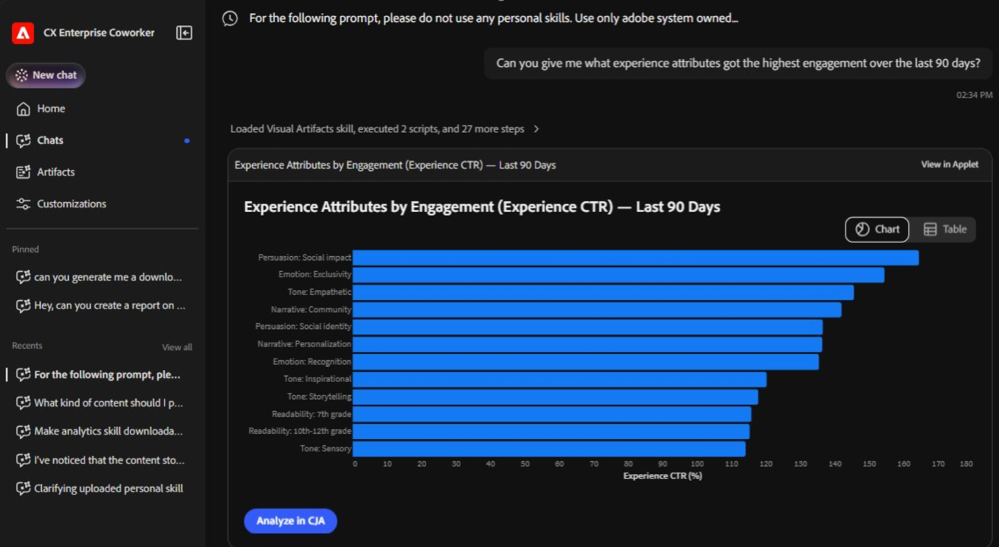

# 컨텐츠 성능 개요

<!-- FLAG: Confidence: High for the first sentence and "Best for" (carried over from analytics-overview.md). Medium for the second sentence, which summarizes the row descriptions from the slides. -->

Adobe CX Enterprise Coworker 채팅을 사용하여 각 에셋의 속성까지, 성과가 좋은 콘텐츠와 그 이유를 파악하여 효과가 있는 콘텐츠에 투자할 수 있습니다. 클릭을 통해 채널 및 대상 전반에서 참여 및 매출을 유도하는 이미지, 메시지 및 테마를 확인할 수 있는 파일을 살펴보십시오.

콘텐츠 성능은 Coworker Chat의 여러 분석 도메인 중 하나입니다. 모든 도메인을 보려면 [동료의 채팅에서 분석 시작](/help/chat/use-cases/data-insights/analytics-overview.md#start-analyzing-in-coworker-chat)과(와) 함께 데이터 분석을 참조하십시오.

**비즈니스 사용자:**&#x200B;을 위한 추천

## 사전 요구 사항

<!-- FLAG: Confidence: High for the first two bullets (sourced from analytics-chat.md and the Skills and limitations table). Low for the third bullet: the attribute-level and image exposure descriptions suggest that these use cases rely on Content Analytics data in Customer Journey Analytics, and implementation-guide.md lists Content Analytics as an implementation path, but no source confirms this. It's a shared bullet rather than a table row because it would apply to every use case on this page. The paid channel row ("Compare Meta ad creative to our web banners") may need an additional data source, which would become an "Additional prerequisite" note on that row in the Use cases table. Confirm with the PM. -->

이 페이지에서 사용 사례를 사용하려면 다음이 필요합니다.

* Customer Journey Analytics 데이터 보기 또는 Adobe Analytics 보고서 세트에 연결된 동료 채팅. [동료 채팅을 사용하여 데이터 분석 시작](/help/chat/use-cases/data-insights/analytics-chat.md)을 참조하세요.
* 분석할 데이터 보기 또는 보고서 세트에 대한 액세스 권한을 봅니다. 동료 채팅은 Customer Journey Analytics 또는 Adobe Analytics의 권한을 상속합니다.
* Customer Journey Analytics에 Content Analytics을 설치하여 Coworker Chat이 컨텐츠 속성 및 이미지 노출을 분석할 수 있도록 합니다. Content Analytics 구현을 계획하려면 [Coworker로 구현 계획](/help/chat/use-cases/data-insights/implementation-guide.md)을 참조하세요.

## 사용 사례

| 사용 사례 | 함수 |
| --- | --- |
| 우수성이 검증된 콘텐츠의 공통점 찾기

 | 클릭된 파일뿐만 아니라 속성 수준에서 작동하는 이미지 및 메시징을 표시합니다.
**샘플 프롬프트:**
<ul><li>&quot;가장 성과가 좋은 이미지는 공통점이 무엇입니까?&quot;</li><li>&quot;가장 많은 참여를 유도하는 콘텐츠 특성은 무엇입니까?&quot;</li></ul> |
| 고객에게 표시되는 컨텐츠에 매출을 연결합니다. | 이미지 노출을 알고리즘 속성 을 통해 매출, 전환 및 참여에 연결합니다.
**전문가:**, 비즈니스 사용자

**샘플 프롬프트:**
<ul><li>&quot;어떤 영웅 이미지가 지난 분기에 가장 많은 매출을 올렸습니까?&quot;</li><li>&quot;이 배너에 얼마나 많은 수익이 연결되어 있습니까?&quot;</li></ul> |
| 유료 채널과 소유 채널 간 크리에이티브 비교 | 웹, 모바일 및 유료 채널에서 우승하는 시각적 개체 및 테마를 한 보기에서 보여줍니다.
**샘플 프롬프트:**
<ul><li>&quot;유료 및 당사 사이트에서 어떤 크리에이티브 테마가 승리합니까?&quot;</li><li>&quot;Meta 광고 크리에이티브를 웹 배너와 비교&quot;</li></ul> |
| 각 대상을 움직이는 시각적 개체 파악 | 개인화 및 Creative Brief를 안내하기 위해 각 대상자에게 작동하는 시각적 개체를 표시합니다.
**샘플 프롬프트:**
<ul><li>&quot;각 세그먼트에 가장 적합한 비주얼은 무엇입니까?&quot;</li><li>&quot;처음 방문하는 사용자에게 적합한 이미지는 무엇입니까?&quot;</li></ul> |

<!--
HIDDEN until the skills are confirmed. To publish, remove this comment wrapper.

## Skills used

FLAG: Confidence: Low. No source in the repo (workflows.md, the Skills and limitations table, or any data insights article) names the skills behind these use cases. Get the skill IDs from the PM, replace the placeholder rows, and add the skills to the Skills and limitations table on analytics-overview.md so that the link above the table covers them. When you unhide this section, wrap this FLAG note in its own HTML comment.

Coworker uses the following skills for the use cases described in this article. For a list of all analytics skills, including the permissions they require and what they don't cover, see [Skills and limitations](/help/chat/use-cases/data-insights/analytics-overview.md#skills-and-limitations) in Analyze data with Coworker Chat.

| Skill | Used for |
| --- | --- |
| *[Skill to be confirmed]* | Find what winning content has in common Attribute revenue to the content customers see Compare creative across paid and owned channels Know which visuals move each audience |

-->

## 더 나은 결과를 위한 팁

<!-- FLAG: Confidence: Medium. The first two bullets are adapted from the best practices in analytics-overview.md. The third bullet is inferred from the row descriptions. -->

* 분석할 지표 및 날짜 범위(예: 지난 분기 매출액)에 이름을 지정합니다.
* 비교할 세그먼트, 대상 또는 채널을 지정합니다.
* 콘텐츠의 성과가 좋은 이유를 알고 싶을 때 개별 파일이 아닌 이미지, 테마 또는 메시지와 같은 콘텐츠 속성에 대해 질문합니다.

## 다음 단계

* 다른 분석 도메인 및 모범 사례를 포함하여 Coworker Chat을 사용한 데이터 분석에 대한 개요를 보려면 [Coworker Chat을 사용하여 데이터 분석](/help/chat/use-cases/data-insights/analytics-overview.md)을 참조하십시오.
* 동료 채팅을 설정하고 작업 예제를 보려면 [동료 채팅을 사용하여 데이터 분석 시작](/help/chat/use-cases/data-insights/analytics-chat.md)을 참조하세요.
