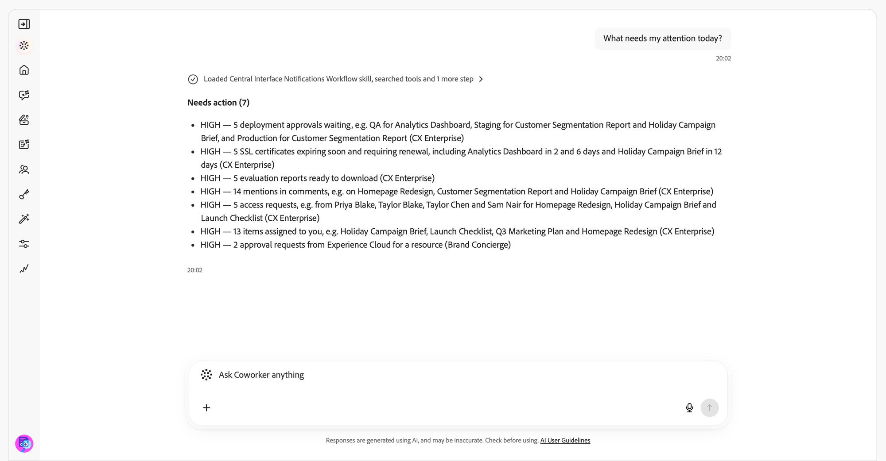

# 알림 기술 {#notification-skills}

Adobe CX Enterprise Coworker의 알림 기술을 사용하여 알림을 검토하고, 작업 항목을 식별하고, 대화를 통해 알림 환경 설정을 관리합니다. Adobe CX Enterprise 애플리케이션의 알림 패널에서 이미 수신한 알림을 사용하여 작업합니다.

알림을 요약하고, 특정 항목을 찾고, 반복되는 알림을 개별 문제로 그룹화합니다. 애플리케이션에서 알림을 열고, 읽음 또는 읽지 않음으로 표시하거나, 미리 알림을 설정합니다.

>[!AVAILABILITY]
>
>알림 기술은 Adobe CX Enterprise Coworker에 액세스할 수 있는 모든 고객이 사용할 수 있습니다. 이 기술을 사용하기 위해 추가 설정이 필요하지 않습니다.
>
>[!DNL Slack]에서 알림을 받으려면 조직에 연결된 [!DNL Slack] 작업 영역이 있어야 합니다.

## 시작하기에 앞서 {#before-you-begin}

시작하기 전에 다음을 확인하십시오.

* Adobe CX Enterprise Coworker 액세스.
* 알림을 보내는 하나 이상의 Adobe CX Enterprise 애플리케이션에 액세스합니다.
* [!DNL Slack]에서 알림을 받으려면 조직의 연결된 [!DNL Slack] 작업 영역입니다.

## 알림 검토 및 조치 {#review-and-act}

요약으로 시작한 다음 요청을 세분화하고 특정 알림에 대해 작업합니다.

1. 동료 채팅을 엽니다. 자세한 내용은 [동료 채팅 시작](/help/chat/ui-guide.md)을 참조하세요.
1. **[!UICONTROL 동료에게 요청하기]** 상자에 요청을 입력한 다음 **[!UICONTROL 보내기]**&#x200B;를 선택합니다. 예:

   *&quot;오늘 내 주의가 필요한 것은 무엇입니까?&quot;*

1. 조치가 필요한 알림과 인식을 위해 제공된 알림을 검토하십시오.

   

1. 후속 질문을 입력하여 결과를 좁히십시오. 예:

   *&quot;이 알림에서 Experience Platform에 오류가 있는지 알 수 있습니까?&quot;*

   

1. 알림에 대한 세부 정보를 요청하거나 애플리케이션에서 열어 조사합니다.
1. 알림을 읽은 것으로 표시하거나 미리 알림을 설정하도록 요청합니다. 예:

   *&quot;앞으로 우선 순위가 높은 수신 이벤트 속도 알림에 대해 미리 알려주십시오.&quot;*

   

이전 요청의 컨텍스트를 반복하지 않고 대화를 계속합니다. 요청이 여러 알림, 애플리케이션 또는 설정에 적용될 수 있는 경우 계속 진행하기 전에 명확한 질문에 답하십시오.

요청 이상으로 확장되는 변경 전에 확인 요청을 받습니다.

## 지원되는 사용 사례 {#supported-use-cases}

알림 기술을 사용하여 사용자에게 전송된 알림을 검토하고, 적용하고, 수신 방법을 관리합니다.

>[!NOTE]
>
>알림 스킬은 알림을 전송, 공유 또는 삭제하지 않습니다.

### 작업 항목 식별 {#identify-action-items}

Adobe CX Enterprise 애플리케이션 전반에 걸쳐 주의가 필요한 알림을 묻습니다.

프롬프트 예:

* &quot;오늘 내 주의가 필요한 것은 무엇인가?&quot;
* &quot;따라와요.&quot;
* &quot;내가 할 일은 없나?&quot;

### 알림 요약 {#summarize-notifications}

기간 또는 애플리케이션에 대한 요약을 요청합니다. 인식을 위해 제공된 알림과 별도로 작업 항목을 검토합니다. 반복된 알림은 개별적으로 나열되지 않고 별개의 문제로 그룹화됩니다.

프롬프트 예:

* &quot;지난 주의 내 알림을 요약합니다.&quot;
* &quot;마지막 날 알림에 대한 개요를 제공합니다.&quot;
* &quot;내 Adobe Journey Optimizer 알림 요약&quot;

### 특정 알림 찾기 {#find-specific-notifications}

읽지 않음 상태, 승인 요청, 실패, 오류 또는 제품 릴리스와 같은 기준으로 알림을 필터링합니다.

프롬프트 예:

* &quot;읽지 않은 알림만 표시합니다.&quot;
* &quot;내 승인 요청을 표시합니다.&quot;
* &quot;알아야 할 중요한 오류 경고가 있습니까?&quot;
* &quot;Experience Platform에 대한 릴리스 알림을 표시합니다.&quot;

### 알림 세부 정보 검토 {#review-notification-details}

알림이 전송된 대로 알림의 전체 세부 정보를 요청합니다. 여러 알림이 요청과 일치하는 경우 원하는 알림을 지정합니다.

프롬프트 예:

* &quot;여정 알림에 대해 자세히 알려주십시오.&quot;
* &quot;이 경보는 나에게 어떤 의미입니까?&quot;

### 알림에 관한 법률 {#act-on-notifications}

애플리케이션에서 알림을 열고, 알림을 읽음 또는 읽지 않음으로 표시하거나, 미리 알림을 설정합니다. 5분, 15분, 1시간 또는 내일 미리 알림을 선택하십시오.

프롬프트 예:

* &quot;해당 알림을 읽은 상태로 표시합니다.&quot;
* &quot;해당 알림을 읽지 않은 상태로 표시합니다.&quot;
* &quot;1시간 후에 이 알림에 대해 다시 알려주십시오.&quot;
* &quot;모든 알림을 읽은 상태로 표시합니다.&quot;

### 알림 환경 설정 관리 {#manage-notification-preferences}

알림 수신 방법을 변경하기 전에 현재 설정에 대해 질문하십시오. 갱신할 응용 프로그램 또는 알림 범주를 지정합니다.

| 환경 설정 | 사용 가능한 변경 사항 |
| --- | --- |
| 게재 채널 | 응용 프로그램 내의 알림, 전자 메일 알림 또는 응용 프로그램 또는 범주에 대한 [!DNL Slack] 알림을 켜거나 끕니다. |
| 이메일 빈도 | 즉시 이메일 게재 또는 일별 또는 주별 다이제스트를 선택합니다. |
| 범주 우선 순위 | 우선 순위가 높은 알림 범주를 선택합니다. |
| 팝업 경고 | 팝업 경고를 표시할 알림 범주를 선택합니다. |

프롬프트 예:

* &quot;Adobe Journey Optimizer에 대한 내 알림 설정은 무엇입니까?&quot;
* &quot;Experience Platform에 대해 [!DNL Slack] 알림을 사용하지 않도록 설정하십시오.&quot;
* &quot;일별 요약에서 주별 요약으로 전환하십시오.&quot;
* &quot;릴리스 업데이트 알림 음소거&quot;
* &quot;Adobe Journey Optimizer 알림만 이메일로 보냅니다.&quot;

동료 채팅에서 일정 세부 정보를 요청하는 경우 주간 다이제스트에 대한 일, 시간 및 시간대를 지정합니다.

## 이 항목에 대한 추가 도움말 {#more-help}

이 안내서를 사용하여 동료 채팅을 시작하거나 Experience Platform 경고 활동을 조사하십시오.

* [동료 채팅 시작](/help/chat/ui-guide.md)
* [고객 경고 기술](/help/chat/use-cases/customer-alerts/customer-alerts.md)
