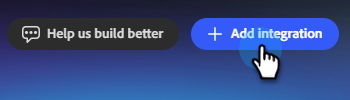

# 데이터베이스에 연결 {#databricks}

Adobe Coworker for teams를 사용하면 Databricks 작업 영역에서 Unity Catalog 테이블을 연결하고 쿼리하여 캠페인 대상을 빌드하고 활성화할 수 있습니다.

>[!PREREQUISITES]
>
>이 커넥터를 사용하려면 먼저 다음을 수행해야 합니다.
>
>* 활성 Databricks 계정
>* Databricks Workspace 호스트, [SQL 웨어하우스 경로](https://docs.databricks.com/aws/en/compute/sql-warehouse/create){target="_blank"}, [개인 액세스 토큰](https://learn.microsoft.com/en-us/azure/databricks/dev-tools/auth/pat){target="_blank"} 및 [Unity 카탈로그](https://learn.microsoft.com/en-us/azure/databricks/discover/database-objects){target="_blank"}가 편리합니다.

## 연결 방법

1. [Coworker for teams 홈 페이지](https://coworker-campaigns.experience.adobe.com/){target="_blank"}에서 **컨텍스트**&#x200B;를 클릭하고 **커넥터**&#x200B;를 선택합니다.

   

1. **통합 추가**&#x200B;를 클릭합니다.

   

   >[!NOTE]
   >
   >첫 번째 통합이 아닌 경우 버튼에 &quot;커넥터 추가&quot;가 표시됩니다.

1. Databricks 행에서 **연결**&#x200B;을 클릭합니다.

   연결 단추가 있는 

1. 데이터베이스 **Workspace 호스트**, **SQL 웨어하우스 경로**, **개인 액세스 토큰** 및 **Unity 카탈로그**&#x200B;를 입력하십시오. **연결**&#x200B;을 클릭합니다.

   >[!NOTE]
   >
   >Databricks 홈 페이지의 경우 브라우저의 주소 표시줄에 Workspace 호스트를 직접 찾을 수 있습니다. 다른 자격 증명을 모두 찾으려면 이 문서 상단의 **필수 구성 요소**&#x200B;에 있는 링크를 참조하십시오.

   

연결 후 Databricks 가 Connectors 목록에 나타납니다.

**연결을 끊으려면:**

1. Connectors 화면에서 Databricks 타일을 찾아 **관리**&#x200B;를 클릭합니다.

1. **연결 해제**&#x200B;를 클릭합니다(지금은 개인 액세스 토큰을 다시 입력할 필요가 없음).

1. 확인하려면 **연결 끊기**&#x200B;를 다시 클릭하세요.
