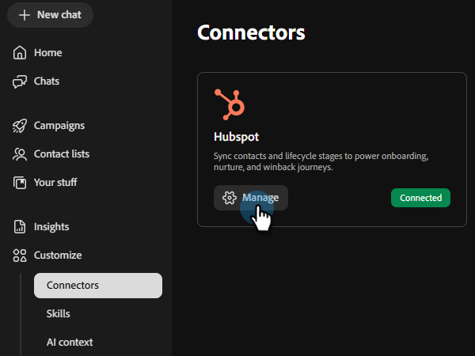

# HubSpot에 연결 {#hubspot}

Teams용 동료는 HubSpot 계정을 연결하여 연락처 목록을 가져올 수 있도록 해줍니다.

>[!PREREQUISITES]
>
>이 커넥터를 사용하려면 먼저 다음을 수행해야 합니다.
>
>* 활성 HubSpot 계정
>* 다음 범위를 추가하여 [서비스 키](https://developers.hubspot.com/docs/apps/developer-platform/build-apps/authentication/account-service-keys#create-a-service-key){target="_blank"}을(를) 만들었습니다. `crm.objects.contacts.read`, `crm.objects.leads.read`, `crm.schemas.contacts.read`, `crm.lists.read`, `crm.export`

## 연결 방법

1. [Coworker for teams 홈 페이지](https://coworker-campaigns.experience.adobe.com/){target="_blank"}에서 **컨텍스트**&#x200B;를 클릭하고 **커넥터**&#x200B;를 선택합니다.

   

1. **통합 추가**&#x200B;를 클릭합니다.

   

   >[!NOTE]
   >
   >첫 번째 통합이 아닌 경우 버튼에 &quot;커넥터 추가&quot;가 표시됩니다.

1. HubSpot 행에서 **연결**&#x200B;을 클릭합니다.

   연결 단추가 강조 표시된 

1. 필요한 권한(이 문서 상단의 사전 요구 사항에 나열됨)이 표시되는 모달이 나타납니다. **계속**&#x200B;을 클릭합니다.

1. HubSpot **서비스 키**&#x200B;를 입력하고 **연결**&#x200B;을 클릭합니다.

   

연결 후 HubSpot이 커넥터 목록에 나타나며 HubSpot에서 동기화할 연락처 목록을 연결할 때 선택할 수 있습니다.

**연결을 끊으려면:**

1. Connectors 화면에서 HubSpot 타일을 찾아 **관리**&#x200B;를 클릭합니다.

   관리 버튼이 강조 표시된 HubSpot을 표시하는 

1. **연결 해제**&#x200B;를 클릭합니다(지금은 서비스 키를 다시 입력할 필요가 없음).

   

1. 확인하려면 **연결 끊기**&#x200B;를 다시 클릭하세요.

   
