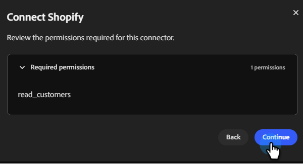

# Shopify에 연결 {#shopify}

Coworker for teams를 사용하면 Shopify 계정을 연결하여 고객 및 세그먼트를 가져올 수 있습니다.

>[!PREREQUISITES]
>
>이 커넥터를 사용하려면 먼저 다음을 수행해야 합니다.
>
>* 활성 Shopify 계정
>* Shopify의 다음 권한: `read_customers`
>* Shopify 저장소 URL 및 [관리 API 액세스 토큰](https://shopify.dev/docs/apps/build/authentication-authorization){target="_blank"} 사용 가능

## 연결 방법

1. [Coworker for teams 홈 페이지](https://coworker-campaigns.experience.adobe.com/){target="_blank"}에서 **컨텍스트**&#x200B;를 클릭하고 **커넥터**&#x200B;를 선택합니다.

   

1. **통합 추가**&#x200B;를 클릭합니다.

   

   >[!NOTE]
   >
   >첫 번째 통합이 아닌 경우 버튼에 &quot;커넥터 추가&quot;가 표시됩니다.

1. Shopify 행에서 **연결**&#x200B;을 클릭합니다.

   

1. 필요한 권한을 검토하고 **계속**&#x200B;을 클릭합니다.

   

1. Shopify **스토어 URL** 및 **관리 API 액세스 토큰**&#x200B;을 입력하십시오. **연결**&#x200B;을 클릭합니다.

>[!NOTE]
>
>Shopify에서 **설정** › **앱** › **앱 개발** › **기존 사용자 지정 앱 만들기** › **관리 API 구성** › **필수 범위 추가**&#x200B;를 통해 관리 API 액세스 토큰을 얻습니다.

연결 후 Shopify가 Connectors 목록에 나타납니다.

**연결을 끊으려면:**

1. Connectors 화면에서 Shopify 타일을 찾아 **관리**&#x200B;를 클릭합니다.

1. **연결 해제**&#x200B;를 클릭합니다(지금은 관리 API 액세스 토큰을 다시 입력할 필요가 없음).

1. 확인하려면 **연결 끊기**&#x200B;를 다시 클릭하세요.
