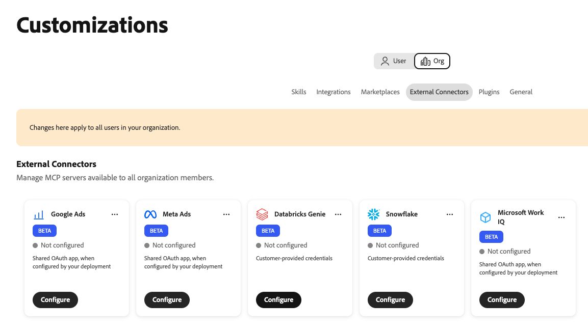
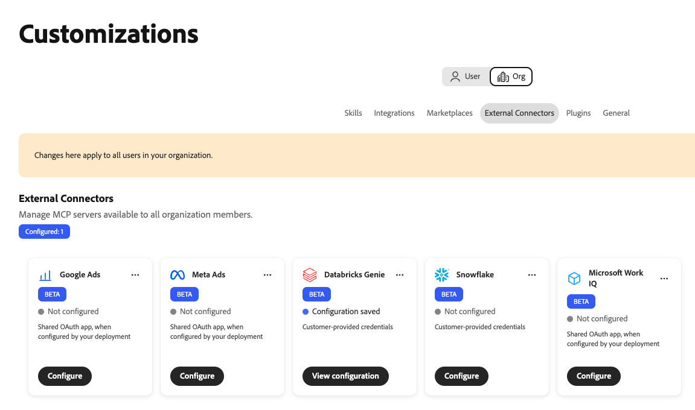
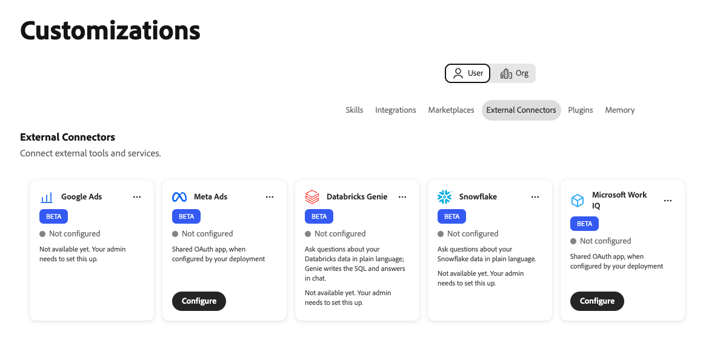
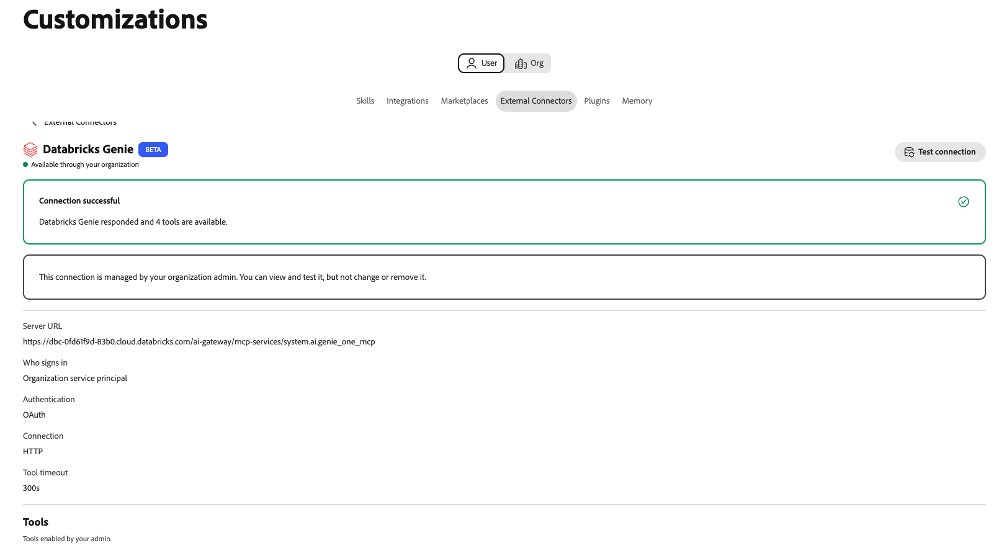

# Databricks Genie 외부 커넥터 {#databricks-genie}

[!DNL Databricks Genie] 외부 커넥터를 사용하여 Adobe CX Enterprise Coworker에서 [!DNL Databricks] 데이터에 대해 일반 언어로 질문할 수 있습니다. [!DNL Genie]이(가) SQL을 쓰고 채팅에서 답변을 반환합니다. 커넥터는 Coworker를 [!DNL Databricks] 작업 영역의 [!DNL Genie One] MCP(Model Context Protocol) 서버에 연결합니다.

>[!AVAILABILITY]
>
>[!DNL Databricks Genie] 외부 커넥터가 Beta 버전입니다. 설명서 및 기능은 변경될 수 있습니다.

## 커넥터 구성 {#connector-configuration}

커넥터 구성 프로세스에는 두 개의 별도 부품이 있습니다.

* **조직 설정:** 관리자가 Coworker를 [!DNL Databricks] 작업 영역에 연결하고 사람들이 로그인하는 방법을 선택하고 구성원이 사용할 수 있는 도구를 선택합니다.
* **구성원 액세스:** 구성원은 로그인 옵션에 따라 공유 조직 ID 또는 자신의 [!DNL Databricks] ID로 연결을 사용합니다.

관리자는 다음 로그인 옵션 중 하나를 선택합니다.

| 옵션 | 관리자가 제공하는 사항 | 액세스 작동 방식 |
| --- | --- | --- |
| **[!UICONTROL 조직 서비스 사용자]** | [!DNL Databricks] 서비스 주체의 클라이언트 ID 및 클라이언트 암호입니다. | 모든 구성원은 서비스 주체의 권한을 사용합니다. 구성원이 [!DNL Databricks]에 로그인하지 않습니다. |
| **[!UICONTROL 각 사용자가 로그인함]** | [!DNL Databricks] OAuth 앱 연결의 클라이언트 ID와 선택적 클라이언트 암호입니다. | 각 구성원은 자신의 [!DNL Databricks] ID로 로그인하며 액세스는 해당 [!DNL Databricks] 권한을 따릅니다. |

두 옵션 모두 선택한 ID에 없는 [!DNL Databricks] 권한을 부여하지 않습니다. [!DNL Databricks]은(는) 모든 요청에 [!DNL Unity Catalog] 권한을 적용합니다.

## 사전 요구 사항 {#prerequisites}

이 커넥터는 [!DNL Databricks Genie One]에서 작동합니다. 레거시 [!DNL Genie] 공간 MCP URL을 지원하지 않습니다. [!DNL Databricks SQL] 서버와 같은 다른 [!DNL Databricks] MCP 서버를 연결하려면 별도로 통합으로 추가하십시오.

시작하기 전에 다음을 확인하십시오.

* **조직 설정의 경우:** Coworker에서 조직 커넥터를 관리할 수 있는 권한이 있는 계정입니다.
* **[!DNL Databricks] 작업 영역의 경우:** [!DNL Genie One]을(를) 사용할 수 있는 작업 영역의 HTTPS URL입니다.
* **서비스 주체 옵션:** [!DNL Databricks] 서비스 주체의 클라이언트 ID 및 클라이언트 암호입니다.
* **사용자별 로그인 옵션:** [!DNL Databricks] OAuth 앱 연결 및 해당 클라이언트 ID입니다. Coworker 리디렉션 URL을 등록할 수 있는 [!DNL Databricks] 관리자도 필요합니다.
* **[!DNL Databricks]에 대한 액세스:** Workspace, [!DNL Genie] 및 사용할 ID에 대한 데이터 사용 권한. 동료는 이러한 권한을 부여하지 않습니다.

>[!IMPORTANT]
>
>스크린샷, 채팅 또는 지원 티켓에서 클라이언트 암호, 액세스 토큰 또는 기타 자격 증명을 공유하지 마십시오.

지침은 다음 [!DNL Databricks] 설명서를 참조하십시오.

* [지니원](https://docs.databricks.com/aws/en/agents/mcp-tools/genie-mcp){target="_blank"}
* [파트너 OAuth 애플리케이션 활성화 또는 비활성화](https://docs.databricks.com/aws/en/integrations/enable-disable-oauth){target="_blank"}
* [OAuth를 통해 데이터 저장소에 대한 서비스 주체 액세스 권한 인증](https://docs.databricks.com/aws/en/dev-tools/auth/oauth-m2m){target="_blank"}

## 조직을 위한 커넥터 구성 {#configure-organization}

관리자는 조직의 모든 사용자가 [!DNL Databricks Genie] 커넥터를 사용할 수 있도록 합니다. 조직 페이지의 변경 사항은 조직의 모든 사용자에게 적용됩니다. 조직 관리자만 이 연결을 추가할 수 있습니다. 구성원은 **[!UICONTROL 사용자]** 보기에서 구성할 수 없습니다.

1. **[!UICONTROL 사용자 지정]**&#x200B;을 열고 **[!UICONTROL 조직]**&#x200B;을 선택한 다음 **[!UICONTROL 외부 커넥터]**&#x200B;를 선택합니다. **[!UICONTROL Databricks Genie]** 카드에서 **[!UICONTROL 구성]**&#x200B;을 선택합니다.

   {width="700" zoomable="yes"}

1. **[!UICONTROL Connect Databricks Genie]** 대화 상자에서 **[!UICONTROL 서버 URL]**&#x200B;에 작업 공간 URL 또는 [!DNL Genie One] MCP URL을 입력하십시오. Coworker는 소스를 다음 형식으로 저장합니다.

   ```text
   https://<workspace-host>/ai-gateway/mcp-services/system.ai.genie_one_mcp
   ```

   고유한 작업 공간에 대한 URL을 사용합니다. Coworker는 HTTPS를 사용하지 않거나 지원되지 않는 경로를 사용하는 URL을 거부합니다. `/api/2.0/mcp/genie/<space-id>`과(와) 같은 레거시 [!DNL Genie] 공간 URL은 지원되지 않습니다.

1. **[!UICONTROL 누가 로그인합니까?]**&#x200B;에서 로그인 옵션을 선택한 다음 설정을 완료합니다.

   {width="500" zoomable="yes"}

   * **[!UICONTROL 조직 서비스 사용자]:** 요청에서 서비스 사용자의 권한을 사용합니다. 중앙 집중식 관리 또는 자동화된 액세스에 이 옵션을 사용합니다. 구성원이 [!DNL Databricks]에 로그인하지 않습니다.

     | 설정 | 설명 |
     | --- | --- |
     | **[!UICONTROL 서비스 사용자 클라이언트 ID]** | 필수 여부. [!DNL Databricks] 서비스 주체의 클라이언트 ID입니다. 서비스 주체를 설정하려면 대화 상자에서 **[!UICONTROL 서비스 주체를 설정하는 방법]**&#x200B;을 선택하십시오. |
     | **[!UICONTROL 서비스 사용자 클라이언트 암호]** | 필수 여부. 서비스 보안 주체의 클라이언트 암호입니다. 동료는 비밀을 안전하게 보관하고 조직 서비스 교장을 위해 사용합니다. |

   * **[!UICONTROL 각 사용자가 로그인함]:** 요청은 각 사용자의 [!DNL Databricks] 권한을 사용합니다. 관리되는 사용자 기반 액세스에는 이 옵션을 사용합니다. 각 구성원은 자신의 [!DNL Databricks] ID로 앱을 인증합니다.

     | 설정 | 설명 |
     | --- | --- |
     | **[!UICONTROL 리디렉션 URL]** | 읽기 전용. 이 URL을 복사하고, [!DNL Databricks] 계정 콘솔에서 Coworker를 OAuth 앱 연결로 등록할 때 추가합니다. 지침은 대화 상자에서 **[!UICONTROL OAuth 앱 연결을 추가하는 방법]**&#x200B;을 선택하십시오. 리디렉션 URL은 환경마다 다르므로 항상 대화 상자에서 복사하십시오. |
     | **[!UICONTROL OAuth 앱 클라이언트 ID]** | 필수 여부. 앱 연결을 만든 후 [!DNL Databricks]에 표시되는 클라이언트 ID입니다. 동료는 이 필드를 사용하여 각 사용자를 [!DNL Databricks] 로그인 페이지로 보냅니다. |
     | **[!UICONTROL OAuth 앱 클라이언트 암호]** | 선택 사항입니다. 비밀 클라이언트로 앱 연결을 만든 경우에만 암호를 입력합니다. 클라이언트 암호가 없으면 앱은 공개 클라이언트 구성을 사용합니다. |

   Coworker는 작업 영역에서 OAuth URL 및 범위를 파생합니다. 인증 유형 및 연결 프로토콜은 고정되어 있으며 읽기 전용입니다. OAuth 앱에 대한 조직의 승인 프로세스와 OAuth 앱이 요청하는 액세스를 따르십시오.

   >[!IMPORTANT]
   >
   >조직 서비스 주체를 사용하면 이 연결을 사용하는 모든 사람이 서비스 주체의 권한으로 작동합니다.

1. **[!UICONTROL 사용자가 사용할 수 있는 도구]**&#x200B;에서 구성원이 사용할 수 있는 도구를 선택합니다. 커넥터는 기본적으로 사용할 수 있는 다음 도구를 제공합니다.

   | 도구 | 설명 |
   | --- | --- |
   | `genie_ask` | [!DNL Genie]에게 질문합니다. |
   | `genie_poll_response` | 아직 진행 중인 응답의 상태를 확인합니다. |
   | `genie_get_query_result` | 쿼리 결과를 검색합니다. |
   | `genie_cancel_response` | 응답을 취소합니다. |

   조직의 모든 사용자를 위한 도구를 차단하려면 해당 태그를 제거하십시오. 동료는 제거한 도구를 조직의 제외로 저장합니다. 하나 이상의 도구는 활성화 상태를 유지해야 합니다. 도구를 제거하면 **[!UICONTROL 모든 도구 복원]** 옵션이 나타납니다. 제외를 지우고 모든 도구를 다시 사용할 수 있도록 하려면 선택합니다.

   ![사용자가 사용할 수 있는 도구 아래의 네 개의 도구 태그, 액세스 및 사용 권한 알림, 인증, 연결 및 도구 시간 초과 요약을 표시하는 [데이터베이스 지니에 연결] 대화 상자](./assets/databricks-genie/org-tools.png){width="500" zoomable="yes"}

   구성원은 사용자가 활성화한 도구만 보고 사용할 수 있으며 도구 선택을 변경할 수 없습니다. 도구를 사용하도록 설정해도 구성원에게 [!DNL Databricks] 추가 권한이 부여되지 않습니다. 도구 시간 제한은 300초로 고정되어 있습니다.

1. **[!UICONTROL 액세스 및 권한]**&#x200B;을 검토한 다음 **[!UICONTROL 연결 저장]**&#x200B;을 선택하십시오. **[!UICONTROL Databricks Genie]** 카드에 **[!UICONTROL 저장된 구성]**&#x200B;이 표시됩니다.

   {width="700" zoomable="yes"}

   작업 영역, 인증, 활성화된 도구 및 도구 시간 제한을 검토하려면 **[!UICONTROL 구성 보기]**&#x200B;를 선택하십시오. 그런 다음 **[!UICONTROL 테스트]**&#x200B;를 선택하여 연결을 확인합니다.

   {width="700" zoomable="yes"}

테스트가 성공해도 선택한 ID에 필요한 [!DNL Databricks] 권한이 있는지 확인되지 않습니다.

## 커넥터를 멤버로 사용 {#use-as-member}

관리자가 커넥터를 구성한 후 자신의 **[!UICONTROL 사용자 지정]** 보기에서 엽니다. 구성원은 연결을 보고 테스트할 수 있지만 변경하거나 제거할 수는 없습니다.

1. **[!UICONTROL 사용자 지정]**&#x200B;을 열고 **[!UICONTROL 사용자]**&#x200B;을 선택한 다음 **[!UICONTROL 외부 커넥터]**&#x200B;를 선택합니다.

1. **[!UICONTROL Databricks Genie]** 카드를 찾습니다. 조직에서 커넥터를 구성하지 않은 경우 카드에 **[!UICONTROL 구성되지 않음]** 및 **[!UICONTROL 아직 사용할 수 없음}이 표시됩니다. 관리자가 이를 설정해야 합니다.]** 구성원에 대한 **[!UICONTROL 구성]** 단추가 없으므로 관리자에게 [커넥터 구성](#configure-organization)을 요청하십시오.

   {width="700" zoomable="yes"}

1. 조직에서 서비스 주체를 사용하는 경우 카드에 **[!UICONTROL 조직을 통해 사용 가능]**&#x200B;이 표시됩니다. 로그인할 필요가 없습니다. 연결을 확인하려면 커넥터 세부 정보를 열고 **[!UICONTROL 연결 테스트]**&#x200B;를 선택하십시오.

   {width="700" zoomable="yes"}

   테스트가 성공하면 **[!UICONTROL 연결 성공]** 및 사용 가능한 도구 수가 표시됩니다.

   {width="700" zoomable="yes"}

1. 조직에서 사용자별 로그인을 사용하는 경우 카드에 **[!UICONTROL 로그인 필요]**&#x200B;가 표시됩니다. 커넥터를 열고 로그인을 시작한 다음 원하는 계정으로 [!DNL Databricks]에 로그인합니다. 필요한 SSO(Single Sign-On) 또는 MFA(Multi-Factor Authentication) 단계를 완료합니다.

1. Coworker로 돌아간 후 커넥터에 **[!UICONTROL 연결됨]**&#x200B;이 표시되는지 확인하십시오. 관리자가 사용하도록 설정한 도구를 검토하고 필요한 경우 **[!UICONTROL 연결 테스트]**&#x200B;를 선택하십시오.

구성원 보기는 읽기 전용입니다. 연결 상태 및 관리자가 활성화한 도구가 표시됩니다. 조직의 OAuth 클라이언트 암호를 입력하거나 도구 선택을 변경하지 않습니다. 연결에 실패하면 커넥터 세부 사항에 오류 및 기술 세부 사항이 표시됩니다. 기술 세부 정보를 복사하여 관리자와 공유합니다.

연결된 상태는 특정 데이터에 대한 액세스를 보장하지 않습니다. [!DNL Databricks] 작업 영역, [!DNL Genie] 및 데이터 권한이 계속 적용됩니다.

## 액세스 문제 해결 {#troubleshoot-access}

설정, 로그인 또는 액세스가 실패할 경우 관리자에게 다음 사항을 확인하십시오.

| 문제 | 확인할 사항 |
| --- | --- |
| 서버 URL이 거부되었습니다. | URL은 HTTPS를 사용하며 작업 영역 원본 또는 정확한 [!DNL Genie One] MCP URL입니다. 기존 [!DNL Genie] 공간 경로와 지원되지 않는 다른 경로를 제거하십시오. |
| OAuth 로그인이 실패하거나 리디렉션 URL이 일치하지 않음 | [!DNL Databricks] OAuth 앱 연결에 동일한 Coworker 환경의 정확한 리디렉션 URL이 있습니다. 클라이언트 ID와 클라이언트 암호(사용하는 경우)가 올바릅니다. |
| 서비스 사용자 연결에 실패했습니다. | 클라이언트 ID 및 클라이언트 암호는 의도한 서비스 주체에 속하고, 클라이언트 암호는 유효하며, 서비스 주체는 작업 영역에 액세스할 수 있습니다. |
| 로그인에 성공했지만 [!DNL Genie]개의 요청이 실패했습니다. | 구성원 또는 서비스 사용자에게 필요한 작업 영역, [!DNL Genie] 및 데이터 권한이 있습니다. 관리자는 기술 세부 사항 및 활성화된 도구를 검토할 수 있습니다. |
| 구성원이 커넥터를 보거나 구성할 수 없습니다. | 관리자는 먼저 **[!UICONTROL 조직]** 보기에서 [!DNL Databricks Genie]을(를) 구성해야 합니다. 구성원이 이 연결을 만들 수 없습니다. |
