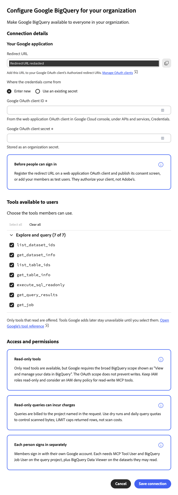
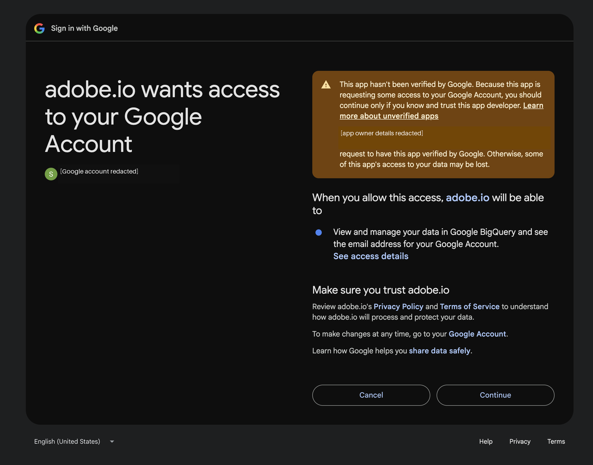
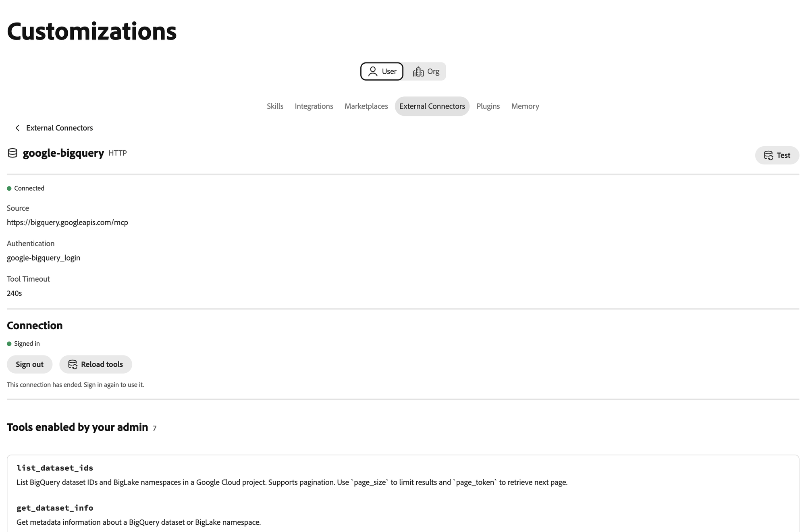

# Google BigQuery 외부 커넥터 {#google-bigquery}

[!DNL Google BigQuery] 외부 커넥터를 사용하여 Adobe CX Enterprise Coworker에서 [!DNL BigQuery] 데이터를 탐색하고 쿼리합니다. 커넥터를 설정한 후 Coworker에게 데이터 세트 및 테이블을 나열하도록 요청하고, 테이블 스키마를 설명하고, 읽기 전용 SQL 쿼리를 실행합니다. 커넥터는 `https://bigquery.googleapis.com/mcp`의 [!DNL Google]이(가) 호스팅하는 MCP(모델 컨텍스트 프로토콜) 서버입니다.

>[!AVAILABILITY]
>
>[!DNL Google BigQuery] 외부 커넥터가 Beta 버전입니다. 설명서 및 기능은 변경될 수 있습니다.

## 커넥터 구성 {#connector-configuration}

커넥터 구성 프로세스에는 세 개의 개별 부품이 있습니다.

* **[!DNL Google Cloud]준비:** [!DNL Google Cloud] 관리자가 쿼리 프로젝트를 준비하고 [!DNL BigQuery] API를 사용하도록 설정하며 구성원에게 필요한 IAM(Identity and Access Management) 역할을 부여합니다.
* **조직 설정:** 동료 관리자가 전체 조직에 대해 커넥터를 한 번 구성합니다. 관리자는 조직의 [!DNL Google] OAuth 앱을 연결하고 구성원이 사용할 수 있는 도구를 선택합니다.
* **구성원 로그인:** 각 구성원이 자신의 [!DNL Google] 계정으로 로그인합니다. 구성원은 [!DNL Google] ID가 액세스할 수 있는 프로젝트 및 데이터 세트에만 액세스할 수 있습니다.

커넥터는 조직이 소유한 OAuth 앱을 사용합니다. Adobe은 이 커넥터에 대한 [!DNL Google] OAuth 앱을 제공하지 않습니다. 조직 구성을 저장해도 구성원에 로그인하거나 [!DNL BigQuery] 권한을 부여하지 않습니다. [!DNL Google Cloud] IAM이 데이터에 대한 액세스를 제어하기 때문에 [!DNL Google] 로그인에 성공해도 데이터 집합 액세스 권한을 부여하지 않습니다.

## 사전 요구 사항 {#prerequisites}

시작하기 전에 다음을 확인하십시오.

* [!DNL Google Cloud] 준비:**API를 활성화하고, IAM 역할을 부여하고, [!DNL Google Auth Platform]에서 OAuth 클라이언트를 만들 수 있는 [!DNL Google Cloud] 관리자.**
* **조직 설정의 경우:** Coworker에서 조직 커넥터를 관리할 수 있는 권한이 있는 계정입니다. [!DNL Google] OAuth 웹 응용 프로그램 클라이언트의 클라이언트 ID와 클라이언트 암호 또는 이 ID를 포함하는 기존 조직 암호도 필요합니다.
* **구성원 로그인:** OAuth 앱의 대상자가 허용하고 필요한 IAM 역할이 있는 [!DNL Google] ID입니다.

쿼리 프로젝트의 ID와 구성원이 읽어야 하는 데이터 세트를 알고 있습니다. 쿼리 프로젝트는 쿼리 작업을 실행하고 비용을 지불합니다. 데이터는 다른 프로젝트에 있을 수 있으며 OAuth 클라이언트도 별도의 프로젝트에 속할 수 있습니다. 파일럿의 경우 하나의 프로젝트에 OAuth 클라이언트, 쿼리 작업 및 데이터 세트를 보관할 수 있습니다.

## [!DNL Google Cloud] 준비 {#prepare-google-cloud}

Coworker에서 커넥터를 구성하기 전에 [!DNL Google Cloud]에서 프로젝트 및 구성원 액세스를 준비하십시오. OAuth 앱을 만들고 데이터 액세스 권한을 부여하는 것은 별도의 작업입니다. 커넥터를 사용하는 구성원은 OAuth 앱을 편집할 권한이 필요하지 않습니다.

### 쿼리 프로젝트 준비 {#prepare-query-project}

[!DNL Google Cloud] 관리자가 쿼리 작업을 실행하는 프로젝트를 준비합니다.

1. [Google 클라우드 콘솔](https://console.cloud.google.com/)에서 프로젝트를 선택하거나 만듭니다.
1. [!DNL BigQuery] API가 아직 활성화되지 않은 경우 활성화합니다. API를 사용하면 [!DNL BigQuery] 원격 MCP 서버도 사용할 수 있습니다.
1. 청구 또는 [BigQuery 샌드박스](https://docs.cloud.google.com/bigquery/docs/sandbox)를 선택한 다음 쿼리 프로젝트에서 매일 적절한 [사용자 지정 쿼리 할당량](https://docs.cloud.google.com/bigquery/docs/custom-quotas)을 설정하십시오.

>[!IMPORTANT]
>
>읽기 전용 쿼리는 여전히 비용이 발생할 수 있습니다. [!DNL BigQuery] 비용은 쿼리가 반환하는 행 수가 아니라 쿼리가 검색하는 바이트에 따라 다릅니다. `LIMIT` 절은 반환된 행을 제어하지만 일반적으로 스캔한 바이트는 감소하지 않습니다. 드라이 실행, 명시적 열, 파티션 필터 및 일별 쿼리 할당량을 사용하여 비용을 제어합니다.

자세한 내용은 [!DNL Google Cloud] 설명서에서 [BigQuery 원격 MCP 서버 사용](https://docs.cloud.google.com/bigquery/docs/use-bigquery-mcp)을 참조하십시오.

### IAM 역할 부여 {#grant-iam-roles}

구성원의 [!DNL Google] ID에 다음 역할을 부여합니다. 가능한 경우 관리 그룹을 사용하고 데이터 세트 수준의 데이터 액세스를 선호합니다.

| 역할 | 부여해야 할 위치 | 용도 |
| --- | --- | --- |
| [!UICONTROL MCP 도구 사용자]&#x200B;(`roles/mcp.toolUser`) | MCP 호출에 사용되는 프로젝트 | MCP 도구를 호출합니다. |
| [!UICONTROL BigQuery 작업 사용자]&#x200B;(`roles/bigquery.jobUser`) | 쿼리 프로젝트 | 쿼리 작업을 실행합니다. |
| [!UICONTROL BigQuery 데이터 뷰어]&#x200B;(`roles/bigquery.dataViewer`) | 승인된 데이터 세트 또는 데이터 프로젝트 | 데이터 및 메타데이터 읽기. |

이 읽기 전용 커넥터를 사용하는 경우에만 [!UICONTROL BigQuery 데이터 편집기], [!UICONTROL BigQuery 데이터 소유자] 또는 [!UICONTROL BigQuery 관리자]를 부여하지 마십시오. 추가적인 보호 조치로서 [읽기/쓰기 MCP 도구에 대한 거부 정책](https://docs.cloud.google.com/mcp/prevent-read-write-tool-use)을 고려하십시오. 다른 [!DNL Google] MCP 클라이언트 및 서비스에 영향을 줄 수 있으므로 먼저 [!DNL Google Cloud] 관리자에게 거부 정책의 범위를 검토하도록 요청하십시오. 자세한 내용은 [BigQuery IAM 역할 및 권한](https://docs.cloud.google.com/bigquery/docs/access-control)을 참조하십시오.

## 조직을 위한 커넥터 구성 {#configure-organization}

관리자는 조직의 모든 사용자가 [!DNL Google BigQuery] 커넥터를 사용할 수 있도록 합니다. 조직 페이지의 변경 사항은 조직의 모든 사용자에게 적용됩니다.

1. **[!UICONTROL 사용자 지정]**&#x200B;을 열고 **[!UICONTROL 조직]**&#x200B;을 선택한 다음 **[!UICONTROL 외부 커넥터]**&#x200B;를 선택합니다. **[!UICONTROL Google BigQuery]** 카드에서 **[!UICONTROL 구성]**&#x200B;을 선택합니다.

   커넥터가 이미 구성된 경우 카드에 대신 **[!UICONTROL 구성 보기]**&#x200B;가 표시됩니다.

1. **[!UICONTROL 조직에 대한 Google BigQuery 구성]** 대화 상자에서 **[!UICONTROL Google 응용 프로그램]**&#x200B;의 **[!UICONTROL 리디렉션 URL]**&#x200B;을 복사합니다.

   리디렉션 URL은 환경과 지역 간에 다르므로 항상 대화 상자에서 정확한 값을 복사합니다. 브라우저에서 Coworker 페이지의 URL 또는 [!DNL BigQuery] MCP 서버 URL을 사용하지 마십시오. 하나의 OAuth 클라이언트가 여러 환경을 제공하는 경우 필요한 각 리디렉션 URL을 별도로 등록합니다.

1. [Google 인증 플랫폼](https://console.cloud.google.com/auth/overview)에서 조직의 OAuth 클라이언트를 준비합니다.

   1. **[!UICONTROL 브랜딩]** 및 **[!UICONTROL 대상]**&#x200B;을 구성하세요. 테스트의 외부 앱에 대해 의도한 구성원을 테스트 사용자로 추가합니다. 광범위하게 사용하기 전에 [!DNL Google]의 게시 및 확인 요구 사항을 완료하십시오.
   1. **[!UICONTROL 데이터 액세스]**&#x200B;에서 `https://www.googleapis.com/auth/bigquery` 범위를 추가합니다.
   1. **[!UICONTROL 클라이언트]**&#x200B;에서 **[!UICONTROL 웹 응용 프로그램]** 응용 프로그램 유형으로 OAuth 클라이언트를 만들거나 선택하십시오.
   1. **[!UICONTROL 승인된 리디렉션 URI]**&#x200B;에 복사한 리디렉션 URL을 추가합니다.
   1. 조직의 승인된 암호 처리 프로세스를 통해 **[!UICONTROL 클라이언트 ID]** 및 **[!UICONTROL 클라이언트 암호]**&#x200B;를 가져옵니다.

   구성원은 Adobe에서 제공하는 앱이 아니라 조직에서 소유한 이 앱을 인증합니다. 스크린샷, 채팅 및 설명서에서 클라이언트 암호를 제거하세요.

1. **[!UICONTROL 자격 증명을 가져오는 위치]**&#x200B;에서 다음 옵션 중 하나를 선택하십시오.

   * **[!UICONTROL 새로 입력]:** **[!UICONTROL Google OAuth 클라이언트 ID]** 및 **[!UICONTROL Google OAuth 클라이언트 암호]**&#x200B;를 입력합니다. 동료는 조직 비밀로 입력하는 값을 저장합니다.
   * **[!UICONTROL 기존 암호 사용]:** 클라이언트 ID와 클라이언트 암호를 포함하는 저장된 조직 암호를 선택하십시오.

   조직 커넥터에 개인 암호를 사용하지 마십시오.

   {width="500" zoomable="yes"}

1. **[!UICONTROL 탐색 및 쿼리]** 도구 그룹을 확장합니다. 7개의 도구를 모두 선택한 상태로 유지하거나 구성원에 필요한 도구만 선택합니다. 하나 이상의 도구를 선택해야 합니다. 자세한 내용은 [사용 가능한 도구](#available-tools)를 참조하세요.

   **[!UICONTROL 액세스 및 권한]**&#x200B;에 있는 알림을 검토하십시오.

   * **[!UICONTROL 읽기 전용 도구]:** OAuth 범위는 광범위하며 자체적으로 변경을 금지하지 않습니다. 구성원의 IAM 역할을 읽기 전용으로 유지합니다.
   * **[!UICONTROL 읽기 전용 쿼리는 비용이 발생할 수 있습니다]:** 드라이 실행 및 쿼리 할당량을 사용합니다. `LIMIT` 절은 반환된 행을 제어하지만 스캔한 바이트만 제어합니다.
   * **[!UICONTROL 각 사용자가 개별적으로 로그인합니다]:** 모든 구성원에게는 필요한 IAM 역할이 필요합니다.

   **[!UICONTROL 연결 저장]**&#x200B;을 선택합니다. 조직 카드에 **[!UICONTROL 저장된 구성]** 및 **[!UICONTROL 구성 보기]**&#x200B;가 표시됩니다.

구성을 저장해도 사용자 또는 구성원이 [!DNL Google]에 로그인되지 않습니다. 또한 저장해도 데이터 세트를 쿼리할 수 있는 사용자는 없습니다. 커넥터를 직접 사용하려면 [구성원으로 로그인](#sign-in-as-a-member)의 단계를 따르십시오.

### 사용 가능한 도구 {#available-tools}

[!DNL Google BigQuery] 커넥터는 다음과 같은 읽기 전용 도구를 제공합니다.

| 도구 | 설명 |
| --- | --- |
| `list_dataset_ids` | 지정한 프로젝트의 데이터 세트를 나열합니다. |
| `get_dataset_info` | 데이터 세트의 메타데이터를 읽습니다. |
| `list_table_ids` | 데이터 집합에 테이블 및 뷰를 나열합니다. |
| `get_table_info` | 테이블의 스키마와 메타데이터를 읽습니다. |
| `execute_sql_readonly` | 읽기 전용 SQL 쿼리를 실행하거나, 쿼리를 검색하는 바이트를 예상하기 위해 시험 실행을 수행합니다. |
| `get_query_results` | 쿼리 결과를 검색하거나 오래 실행되는 쿼리를 확인합니다. |
| `get_job` | 쿼리 작업의 상태, 오류 및 통계를 확인합니다. |

쿼리 워크플로의 경우 Coworker가 장기 실행 쿼리 작업을 수행할 수 있도록 `execute_sql_readonly`, `get_query_results` 및 `get_job`을(를) 함께 선택한 상태로 유지합니다. 동료가 [!DNL BigQuery] MCP 서버에서 `execute_sql` 및 `cancel_job` 도구를 제공하지 않습니다. [!DNL Google]이(가) 나중에 서버에 추가하는 도구는 자동으로 사용할 수 없습니다. 도구에 대한 자세한 내용은 [BigQuery MCP 참조](https://docs.cloud.google.com/bigquery/docs/reference/mcp)를 참조하십시오.

도구를 사용할 때는 다음 제한을 고려하십시오.

* [!DNL Google]개의 문서에서 쿼리 결과에 대한 행 수는 3,000개로 제한되고 기본 쿼리 제한 시간은 3분입니다. 커넥터를 사용하여 전체 테이블을 내보내지 마십시오.
* 도구에서 프로젝트를 나열할 수 없습니다. 요청에 알려진 프로젝트 ID를 입력합니다.
* 읽기 전용 SQL은 [!DNL Google Drive] 외부 테이블에서 데이터 또는 리소스 또는 쿼리를 변경하는 문을 지원하지 않습니다.
* 쿼리 결과, 스키마, 데이터 세트 액세스 목록 및 SQL이 채팅에 나타날 수 있습니다. 액세스 권한이 조직의 데이터 처리 정책을 따르는지 확인하십시오.

## 멤버로 로그인 {#sign-in-as-a-member}

관리자가 커넥터를 구성한 후 각 구성원은 자신의 [!DNL Google] 계정으로 로그인합니다. 로그인하는 데 OAuth 클라이언트 암호가 필요하지 않습니다.

1. **[!UICONTROL 사용자 지정]**&#x200B;을 열고 **[!UICONTROL 사용자]**&#x200B;을 선택한 다음 **[!UICONTROL 외부 커넥터]**&#x200B;를 선택합니다. **[!UICONTROL Google BigQuery]** 카드에서 **[!UICONTROL 로그인되지 않음]**&#x200B;을 표시하고 **[!UICONTROL 로그인]**&#x200B;을 선택합니다.

   카드에 관리자가 커넥터를 설정해야 한다고 표시되면 관리자에게 [커넥터를 구성](#configure-organization)하도록 요청하십시오.

1. [!DNL Google] **[!UICONTROL 계정 선택]** 화면에서 필요한 IAM 액세스 권한이 있는 계정을 선택하거나 **[!UICONTROL 다른 계정 사용]**&#x200B;을 선택합니다. 그런 다음 SSO(Single Sign-On) 또는 MFA(Multi-Factor Authentication)와 같이 조직에서 필요로 하는 로그인 단계를 완료합니다.

   이 계정은 Coworker에 사용하는 계정과 다를 수 있습니다.

   {width="500" zoomable="yes"}

1. [!DNL Google]에 **[!UICONTROL Google이 이 앱을 확인하지 않은 경우]** 관리자와 함께 앱과 앱 소유자를 확인하세요. 테스트 앱에 대한 조직 정책에서 허용하는 경우에만 계속합니다. 그렇지 않으면 **[!UICONTROL 안전으로 돌아가기]**&#x200B;를 선택하고 앱 소유자에게 대상, 게시 또는 확인 요구 사항을 해결하도록 요청하십시오.

   ![Google이 편집된 앱 소유자 전자 메일, 고급 링크 및 [안전 장치로 돌아가기] 단추로 이 앱 경고를 확인하지 않았습니다.](./assets/google-bigquery/member-unverified-app.png){width="500" zoomable="yes"}

   동의 화면에서 앱 이름 및 요청된 액세스를 검토합니다. **[!UICONTROL 계속]**&#x200B;을(를) 선택하여 [!DNL Google] 동의 흐름을 완료합니다.

   [!DNL Google]이(가) [!DNL BigQuery] 데이터를 보고 관리하고 [!DNL Google] 계정의 전자 메일 주소를 볼 수 있는 권한을 요청합니다. Coworker에서 읽기 전용 도구만 제공하더라도 표준 [!DNL BigQuery] 범위입니다.

   스크린샷에서 앱의 이름은 adobe.io입니다. 조직의 앱에 고유한 이름이 표시됩니다. 이 이름을 사용한다고 해서 Adobe에서 OAuth 앱을 제공하는 것은 아닙니다.

   >[!IMPORTANT]
   >
   >앱을 인식하고 조직에서 요청된 액세스를 승인하는 경우에만 계속합니다.

   {width="500" zoomable="yes"}

1. 동료로 돌아간 다음 커넥터 세부 정보에서 관리자가 활성화한 **[!UICONTROL 도구]**&#x200B;를 검토하십시오. 구성원은 도구를 볼 수 있지만 도구 선택을 변경할 수는 없습니다. 연결을 확인하려면 **[!UICONTROL 테스트]**&#x200B;를 선택하세요.

   {width="700" zoomable="yes"}

로그인, 테스트 또는 도구 목록에 실패해도 특정 데이터 세트를 쿼리할 수 있는지 확인되지 않습니다. 액세스 권한을 확인하려면 [BigQuery 액세스 권한을 확인](#check-bigquery-access)하세요. 동료가 연결이 종료되었다고 말하면 다시 로그인합니다.

## [!DNL BigQuery] 액세스 확인 {#check-bigquery-access}

데이터를 읽을 수 있는지 확인하려면 새 채팅을 시작하고 읽기 전용 프롬프트를 입력하십시오. 자리 표시자를 [!DNL Google] ID에서 액세스할 수 있는 프로젝트 및 표로 바꿉니다.

프롬프트 예:

* &quot;`YOUR_PROJECT_ID` 프로젝트의 데이터 세트를 나열합니다.&quot;
* &quot;쿼리 작업에 `YOUR_QUERY_PROJECT_ID`을(를) 사용하여 `YOUR_DATA_PROJECT.YOUR_DATASET.YOUR_TABLE`의 스키마를 검사하고 시험 실행으로 스캔을 예측한 다음 집계 요약을 반환합니다.&quot;

결과에 예상한 데이터 세트 또는 데이터가 포함되어 있는지 확인합니다. 원시 테이블 콘텐츠에 대한 요청보다 명시적 열, 집계 및 파티션 필터를 선호합니다. 요청에서 프로젝트 이름을 지정해도 로그인한 ID가 변경되거나 해당 프로젝트에 대한 액세스 권한이 부여되지 않습니다.

## 액세스 문제 해결 {#troubleshoot-access}

로그인 또는 액세스가 실패할 경우 관리자에게 다음 사항을 확인하십시오.

| 문제 | 확인할 사항 |
| --- | --- |
| 카드에 커넥터가 구성되지 않았거나 관리자가 설정해야 한다고 표시됩니다 | 조직 구성은 활성 조직에 대해 저장됩니다. |
| `redirect_uri_mismatch` | Coworker 대화 상자의 정확한 **[!UICONTROL 리디렉션 URL]**&#x200B;이(가) 웹 응용 프로그램 클라이언트의 **[!UICONTROL 승인된 리디렉션 URI]**&#x200B;에 등록되었습니다. |
| `invalid_client` | 클라이언트 ID 및 클라이언트 암호는 웹 애플리케이션 클라이언트에 속하며 선택한 조직 암호가 올바릅니다. |
| `access_denied` 또는 [!DNL Google]이(가) 앱을 확인하지 않았다는 경고 | 앱 소유자는 대상자, 테스트 사용자 자격 조건 및 확인 상태를 확인합니다. 인식하지 못하는 앱은 승인하지 마십시오. |
| 연결이 종료되었거나 토큰이 만료되었습니다. | 멤버로 다시 로그인합니다. |
| `mcp.tools.call`에 대한 권한 거부 | [!UICONTROL MCP 도구 사용자] 역할 및 적용되는 모든 IAM 거부 정책. |
| `bigquery.jobs.create`에 대한 권한 거부 | 쿼리 프로젝트의 [!UICONTROL BigQuery 작업 사용자] 역할입니다. |
| 테이블에 대한 액세스 거부됨 | 데이터 집합에 대한 [!UICONTROL BigQuery 데이터 뷰어] 역할 및 로그인한 [!DNL Google] 계정. |
| `SERVICE_DISABLED` | 오류가 식별한 프로젝트에서 [!DNL BigQuery] API를 사용할 수 있습니다. |
| 일별 쿼리 할당량이 초과되었습니다. | 프로젝트 관리자가 있는 프로젝트의 쿼리 할당량. |
| 데이터 삽입, 업데이트, 삭제, 만들기 또는 삭제 요청이 실패함 | 커넥터는 읽기 전용이며 데이터 또는 리소스 변경을 지원하지 않습니다. |

지원팀에 문의할 때 클라이언트 암호를 공유하거나, 토큰, 인증 코드 또는 고객 데이터에 액세스하지 마십시오.
