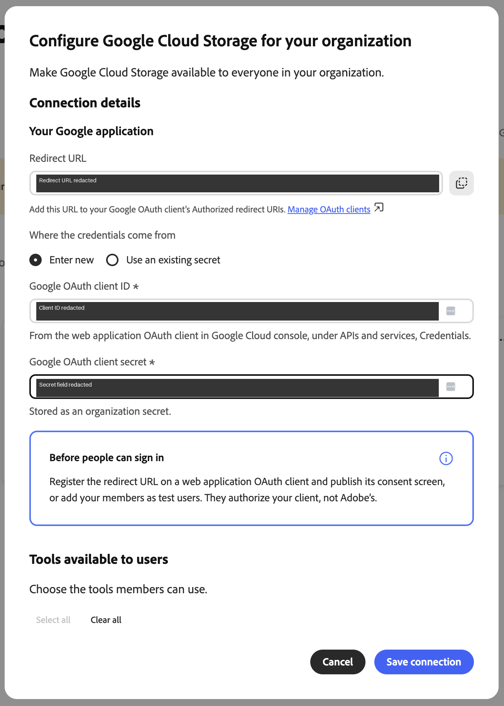
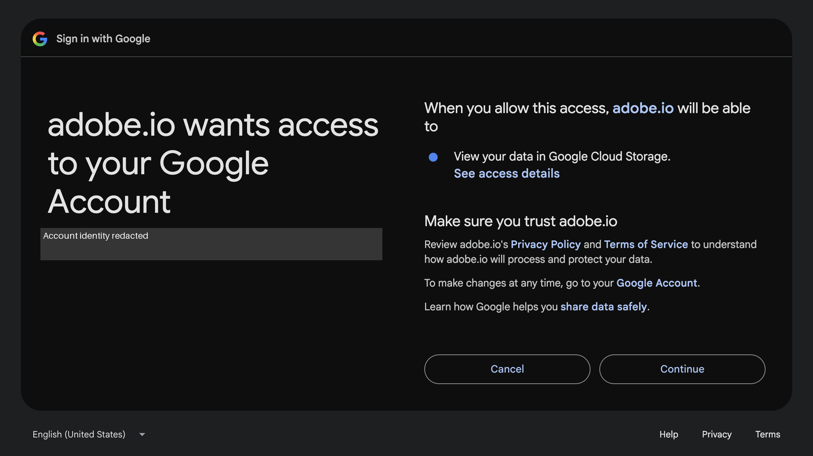

# Google 클라우드 스토리지 외부 커넥터 {#google-cloud-storage}

[!DNL Google Cloud Storage] 외부 커넥터를 사용하여 Adobe CX Enterprise Coworker에서 [!DNL Cloud Storage] 데이터를 읽으십시오. 커넥터를 설정한 후에는 알려진 프로젝트의 버킷을 나열하고, 접두사로 개체를 나열하고, 버킷 및 개체 메타데이터를 검사하고, 승인된 파일을 읽도록 Coworker에 요청합니다. 커넥터가 [!DNL Google]에서 호스트하는 MCP(모델 컨텍스트 프로토콜) 서버입니다.

>[!AVAILABILITY]
>
>[!DNL Google Cloud Storage] 외부 커넥터가 Beta 버전입니다. 설명서 및 기능은 변경될 수 있습니다.

## 커넥터 구성 {#connector-configuration}

커넥터 구성 프로세스에는 세 개의 개별 부품이 있습니다.

* **[!DNL Google Cloud]준비:** [!DNL Google Cloud] 관리자가 청구, [!DNL Cloud Storage] API, 구성원의 ID 및 IAM(Access Management) 역할을 준비합니다. 또한 관리자는 조직이 소유하는 OAuth 클라이언트를 준비합니다.
* **조직 설정:** 동료 관리자가 전체 조직에 대해 커넥터를 한 번 구성합니다. 관리자는 Coworker 리디렉션 URL을 등록하고 OAuth 클라이언트 자격 증명을 입력한 다음 구성원이 사용할 수 있는 도구를 선택합니다.
* **구성원 로그인:** 각 구성원이 자신의 [!DNL Google] 계정으로 로그인합니다. 구성원은 [!DNL Google Cloud] IAM에서 계정에 대해 허용하는 버킷 및 개체에만 액세스할 수 있습니다.

커넥터가 읽기 전용입니다. `https://www.googleapis.com/auth/devstorage.read_only` 범위를 요청하고 읽기 도구만 제공합니다. 조직에서 자체 [!DNL Google] OAuth 애플리케이션을 제공합니다. 이 커넥터에 대한 Adobe 관리 OAuth 애플리케이션이 없습니다.

조직 구성을 저장해도 구성원에 로그인하거나 [!DNL Cloud Storage] 권한을 부여하지 않습니다. 각 구성원은 이미 필요한 IAM 액세스 권한이 있어야 하며 별도로 로그인해야 합니다.

## 사전 요구 사항 {#prerequisites}

시작하기 전에 다음을 확인하십시오.

* [!DNL Google Cloud] 준비:**청구 및 [!DNL Cloud Storage] API가 활성화된 프로젝트, 승인된 데이터가 포함된 버킷, 구성원용 IAM 권한 및**[!UICONTROL &#x200B;웹 애플리케이션&#x200B;]**유형의 [!DNL Google] OAuth 클라이언트.**
* **조직 설정의 경우:** Coworker에서 조직 커넥터를 관리할 수 있는 권한이 있는 계정입니다. 또한 OAuth 클라이언트 ID와 클라이언트 암호 또는 이 ID가 포함된 기존 조직 암호가 필요합니다.
* **구성원 로그인:** OAuth 응용 프로그램 대상자와 [!DNL Google Cloud] IAM이 모두 허용하는 [!DNL Google] 계정입니다.

구성원이 읽을 프로젝트 ID와 버킷을 알고 있습니다. 커넥터에 프로젝트를 나열하는 도구가 없습니다. OAuth 클라이언트는 버킷이 아닌 다른 프로젝트에 속할 수 있습니다.

## Google Cloud 준비 {#prepare-google-cloud}

Coworker에서 커넥터를 구성하기 전에 [!DNL Google Cloud] 프로젝트 및 구성원 액세스 권한을 준비하십시오. [!DNL Google] 로그인에 성공해도 저장소 권한이 부여되지 않습니다.

### 프로젝트 및 IAM 준비 {#prepare-project-iam}

[!DNL Google Cloud] 관리자가 다음 단계를 완료합니다.

1. [Google 클라우드 콘솔](https://console.cloud.google.com/)에서 프로젝트를 선택하거나 만듭니다.
1. 버킷이 포함된 각 프로젝트에 청구 계정을 연결합니다.

   읽기 전용 액세스는 무료가 아닙니다. 스토리지, 운영, 검색 및 네트워크 요금은 계속 적용됩니다. 자세한 내용은 [클라우드 저장소 가격](https://cloud.google.com/storage/pricing)을 참조하세요.

1. 각 관련 프로젝트에서 **[!UICONTROL 클라우드 저장소 API]**&#x200B;를 사용하도록 설정하십시오. OAuth 클라이언트가 개별 프로젝트에 속하는 경우 해당 프로젝트에서도 API를 활성화합니다.
1. 다음 표에서 구성원에게 가장 권한이 낮은 역할을 부여합니다. 개별 계정보다 관리 그룹을 선호합니다.

| 역할 | 부여 위치 | 용도 |
| --- | --- | --- |
| [!UICONTROL MCP 도구 사용자]&#x200B;(`roles/mcp.toolUser`) | MCP 호출에 사용되는 프로젝트 | MCP 도구를 호출합니다(`mcp.tools.call`). |
| [!UICONTROL 저장소 버킷 뷰어]&#x200B;(`roles/storage.bucketViewer`) 또는 사용자 지정 읽기 전용 역할 | 버킷이 포함된 프로젝트 | 버킷 목록 및 버킷 메타데이터 읽기(`storage.buckets.list` 및 `storage.buckets.get`). |
| [!UICONTROL 저장소 개체 뷰어]&#x200B;(`roles/storage.objectViewer`) | 승인된 각 버킷 또는 멤버가 모든 버킷을 읽을 수 있는 경우 프로젝트 | 개체 나열, 개체 메타데이터 읽기 및 개체 내용 읽기(`storage.objects.list` 및 `storage.objects.get`). |

목록 버킷에만 [!UICONTROL 저장소 관리자]를 부여하지 마십시오. 버킷을 나열할 권한이 없는 구성원은 이름을 제공할 때 인증된 버킷을 계속 읽을 수 있습니다. 자세한 내용은 [!DNL Google Cloud] 설명서의 [클라우드 저장소 IAM 역할](https://docs.cloud.google.com/storage/docs/access-control/iam-roles)을 참조하십시오.

[!DNL Google]은(는) 다른 MCP 클라이언트용 읽기/쓰기 MCP 도구를 차단하는 선택적 IAM 거부 정책도 제공합니다. Coworker 커넥터는 이미 읽기 전용 도구 선택 및 읽기 전용 범위를 사용합니다. 정책을 적용하기 전에 [!DNL Google Cloud] 관리자와 함께 프로젝트 전체 효과를 검토하십시오. 자세한 내용은 [읽기/쓰기 MCP 도구 사용 방지](https://docs.cloud.google.com/mcp/prevent-read-write-tool-use)를 참조하십시오.

### 연결 설정 {#connection-settings}

동료 작업자는 다음 연결 설정을 사용합니다. 설정 대화 상자에는 이러한 값을 입력하지 않습니다.

| 설정 | 값 |
| --- | --- |
| MCP 서버 URL | `https://storage.googleapis.com/storage/mcp`(전역 끝점만) |
| 전송 | 스트리밍 가능 HTTP |
| 인증 서버 | `https://accounts.google.com/` |
| 요청된 범위 | `https://www.googleapis.com/auth/devstorage.read_only` |

자세한 내용은 [!DNL Google Cloud] 설명서의 [클라우드 저장소 원격 MCP 서버 사용](https://docs.cloud.google.com/storage/docs/use-cloud-storage-mcp) 및 [Google MCP 서버 인증](https://docs.cloud.google.com/mcp/authenticate-mcp)을 참조하십시오.

## 조직을 위한 커넥터 구성 {#configure-organization}

관리자는 조직의 모든 사용자가 [!DNL Google Cloud Storage] 커넥터를 사용할 수 있도록 합니다. 조직 페이지의 변경 사항은 조직의 모든 구성원에게 적용됩니다.

1. **[!UICONTROL 사용자 지정]**&#x200B;을 열고 **[!UICONTROL 조직]**&#x200B;을 선택한 다음 **[!UICONTROL 외부 커넥터]**&#x200B;를 선택합니다. **[!UICONTROL Google 클라우드 저장소]** 카드에서 **[!UICONTROL 구성]**&#x200B;을 선택합니다.

   커넥터가 이미 구성된 경우 저장된 구성을 대신 엽니다.

1. **[!UICONTROL 조직에 대한 Google 클라우드 저장소 구성]** 대화 상자의 **[!UICONTROL Google 애플리케이션]**&#x200B;에서 전체 **[!UICONTROL 리디렉션 URL]**&#x200B;을(를) 복사합니다.

   리디렉션 URL은 환경 및 지역에 따라 다릅니다. 항상 대화 상자에서 정확한 값을 복사합니다. 브라우저에 있는 Coworker 페이지의 URL, MCP 서버 URL 또는 다른 환경의 리디렉션 URL을 사용하지 마십시오.

1. [Google 인증 플랫폼](https://console.cloud.google.com/auth/overview)에서 조직에 대한 OAuth 클라이언트를 준비합니다.

   1. 조직에 대해 **[!UICONTROL 브랜딩]** 및 **[!UICONTROL 대상]**&#x200B;을 구성하세요. 테스트의 외부 앱에 대해 의도한 구성원을 테스트 사용자로 추가합니다. 더 넓게 사용하기 전에 적용되는 [!DNL Google] 게시 및 확인 요구 사항을 완료하십시오.
   1. **[!UICONTROL 데이터 액세스]**&#x200B;에서 `https://www.googleapis.com/auth/devstorage.read_only` 범위를 포함하십시오. 커넥터는 읽기/쓰기 또는 전체 제어 범위가 필요하지 않습니다.
   1. **[!UICONTROL 클라이언트]**&#x200B;에서 **[!UICONTROL 응용 프로그램 유형]**&#x200B;이 **[!UICONTROL 웹 응용 프로그램]**(으)로 설정된 OAuth 클라이언트를 만들거나 선택하십시오.
   1. **[!UICONTROL 승인된 리디렉션 URI]**&#x200B;에 복사한 리디렉션 URL을 추가합니다. 한 클라이언트가 여러 환경을 제공하는 경우 각 환경의 리디렉션 URL을 등록합니다.
   1. 조직의 승인된 암호 처리 프로세스를 통해 **[!UICONTROL 클라이언트 ID]** 및 **[!UICONTROL 클라이언트 암호]**&#x200B;를 가져옵니다.

   구성원은 조직이 소유하는 이 OAuth 애플리케이션을 승인합니다. 채팅, 티켓 및 설명서에서 자격 증명을 보관하지 마십시오.

1. **[!UICONTROL 자격 증명을 가져오는 위치]**&#x200B;에서 다음 옵션 중 하나를 선택하십시오.

   * **[!UICONTROL 새로 입력]:** **[!UICONTROL Google OAuth 클라이언트 ID]** 및 **[!UICONTROL Google OAuth 클라이언트 암호]**&#x200B;를 입력합니다. 동료는 조직 비밀로 입력하는 값을 저장합니다.
   * **[!UICONTROL 기존 암호 사용]:** 클라이언트 ID와 클라이언트 암호를 가진 저장된 조직 암호를 선택하십시오.

   조직 커넥터에 개인 암호를 사용하지 마십시오.

   {width="500" zoomable="yes"}

1. **[!UICONTROL 검색 및 읽기(5/5)]**&#x200B;를 확장합니다. 5개의 도구를 모두 선택한 상태로 유지하거나 구성원에 필요한 도구만 선택합니다. 하나 이상의 도구를 선택해야 합니다. 자세한 내용은 [사용 가능한 도구](#available-tools)를 참조하세요.

   **[!UICONTROL 액세스 및 권한]**&#x200B;에서 **[!UICONTROL 읽기 전용 액세스]** 및 **[!UICONTROL 각 사용자가 개별적으로 로그인함]** 알림을 검토하세요. 그런 다음 **[!UICONTROL 연결 저장]**&#x200B;을 선택합니다.

   {width="500" zoomable="yes"}

1. 저장된 **[!UICONTROL google-cloud-storage]** 커넥터 세부 정보를 검토하십시오.

   | 설정 | 설명 |
   | --- | --- |
   | **[!UICONTROL Source]** | MCP 서버 URL `https://storage.googleapis.com/storage/mcp`입니다. |
   | **[!UICONTROL 인증]** | 인증 방법, `google-cloud-storage_login`입니다. |
   | **[!UICONTROL Connection]** | 자신의 로그인 상태입니다. |
   | **[!UICONTROL 도구]** | **[!UICONTROL 모두 선택]** 및 **[!UICONTROL 지우기]** 컨트롤과 선택한 도구 수가 있는 구성원을 위해 선택된 도구입니다. |

   {width="700" zoomable="yes"}

커넥터 세부 정보에 대한 **[!UICONTROL 로그인되지 않음]** 상태는 조직이 아니라 사용자 연결을 참조합니다. 조직 설정을 저장해도 사용자 또는 구성원이 로그인하지 않고 버킷에 대한 액세스를 확인하지 않습니다. 커넥터를 직접 사용하려면 [구성원으로 로그인](#sign-in-as-a-member)의 단계를 따르십시오.

나중에 구성원이 사용할 수 있는 도구를 변경하려면 커넥터 세부 정보 페이지에서 선택 내용을 업데이트한 다음 **[!UICONTROL 도구 선택 저장]**&#x200B;을 선택하십시오. 구성원은 도구 선택을 변경할 수 없습니다.

조직에 대한 커넥터 제공을 중지하려면 커넥터 세부 정보 페이지에서 **[!UICONTROL 제거]**&#x200B;를 선택하세요.

### 사용 가능한 도구 {#available-tools}

[!DNL Google Cloud Storage] 커넥터는 **[!UICONTROL 검색 및 읽기]** 그룹에 다음 읽기 전용 도구를 제공합니다.

| 도구 | 설명 | 필수 권한 |
| --- | --- | --- |
| `list_buckets` | 알려진 [!DNL Google Cloud] 프로젝트에 접두사 필터링 및 페이지 매김과 함께 버킷을 나열합니다. | 프로젝트의 `storage.buckets.list` |
| `list_objects` | 승인된 버킷의 개체 및 접두사를 나열합니다. 목록은 기본적으로 재귀적이지 않습니다. | 버킷의 `storage.objects.list` |
| `get_bucket_metadata` | 위치, 저장소 클래스, 보존 및 버전 관리와 같은 버킷 구성을 읽습니다. | `storage.buckets.get` |
| `get_object_metadata` | 개체 크기, 콘텐츠 유형, 타임스탬프, 생성 및 사용자 지정 메타데이터를 읽습니다. | `storage.objects.get` |
| `read_object` | 오브젝트당 최대 8MiB까지 텍스트 또는 지원되는 바이너리 콘텐츠를 읽습니다. | `storage.objects.get` |

모든 도구 호출에는 일반적으로 관련 프로젝트에서 [!UICONTROL MCP 도구 사용자] 역할을 통해 `mcp.tools.call` 권한도 필요합니다.

커넥터가 더 이상 사용되지 않는 `read_text` 도구 또는 `write_text`, `create_bucket`, `delete_object` 및 `delete_bucket` 도구를 제공하지 않습니다. 쓰기 도구를 켤 수 있는 옵션이 없습니다. [!DNL Google]이(가) 나중에 서버에 추가하는 도구는 5개의 도구를 모두 선택하더라도 자동으로 사용할 수 없습니다.

## 멤버로 로그인 {#sign-in-as-a-member}

관리자가 커넥터를 구성한 후 각 구성원은 자신의 [!DNL Google] 계정으로 로그인합니다. 로그인하는 데 OAuth 클라이언트 암호가 필요하지 않습니다.

1. **[!UICONTROL 사용자 지정]**&#x200B;을 열고 **[!UICONTROL 사용자]**&#x200B;을 선택한 다음 **[!UICONTROL 외부 커넥터]**&#x200B;를 선택합니다. **[!UICONTROL Google 클라우드 저장소]** 카드에서 **[!UICONTROL 로그인]**&#x200B;을 선택합니다.

   로그인하기 전에 카드에 **[!UICONTROL 로그인되지 않음]**&#x200B;이 표시됩니다. 카드에 **[!UICONTROL 구성되지 않음]**&#x200B;이 표시되면 관리자에게 [커넥터 구성](#configure-organization)을 요청하십시오.

1. [!DNL Google] **[!UICONTROL 계정 선택]** 화면에서 필요한 IAM 액세스 권한이 있는 계정을 선택하거나 **[!UICONTROL 다른 계정 사용]**&#x200B;을 선택합니다. SSO(Single Sign-On) 또는 MFA(Multi-Factor Authentication)와 같이 조직에서 필요로 하는 로그인 단계를 완료합니다.

   이 계정은 Coworker에 사용하는 계정과 다를 수 있습니다.

   {width="500" zoomable="yes"}

1. [!DNL Google]에 **[!UICONTROL Google이 이 앱을 확인하지 않은 경우]** 관리자와 함께 앱과 앱 소유자를 확인하세요.

   조직에서 이 앱의 사용을 승인하는 경우 **[!UICONTROL 계속]**&#x200B;을 선택하세요. 그렇지 않으면 **[!UICONTROL 안전으로 돌아가기]**&#x200B;를 선택하고 앱 소유자에게 대상, 게시 또는 확인 요구 사항을 해결하도록 요청하십시오.

   ![Google 화면에서 Google이 테스트 중이므로 이 앱을 확인하지 않았으며 [계속] 및 [안전 옵션으로 돌아가기]를 사용하고 있습니다.](./assets/google-cloud-storage/member-unverified-app.png){width="500" zoomable="yes"}

   동의 화면에서 앱 이름과 요청된 액세스를 검토한 다음 **[!UICONTROL 계속]**&#x200B;을 선택합니다. 커넥터가 읽기 전용 범위와 일치하는 **[!UICONTROL Google 클라우드 저장소에서 데이터 보기]**&#x200B;를 요청합니다.

   스크린샷에서 앱의 이름은 adobe.io입니다. 조직의 앱에 고유한 이름이 표시됩니다. 이 이름을 사용한다고 해서 Adobe에서 OAuth 앱을 제공하는 것은 아닙니다.

   >[!IMPORTANT]
   >
   >앱을 인식하고 조직에서 요청된 액세스를 승인하는 경우에만 계속합니다.

   {width="500" zoomable="yes"}

1. 동료로 돌아가서 로그인이 완료되었는지 확인합니다. 커넥터 세부 정보에서 관리자가 활성화한 **[!UICONTROL 도구]**&#x200B;를 검토하십시오. 관리자가 활성화한 도구만 사용할 수 있습니다.

연결이 종료되거나 세션이 만료되면 다시 로그인하십시오. 관리자가 로그인하면 다른 구성원은 로그인되지 않습니다.

## 버킷 액세스 확인 {#check-bucket-access}

로그인 또는 도구 목록에 의해 특정 버킷에 액세스할 수 있는지 확인되지 않습니다. [!DNL Google]은(는) 서버 도구를 나열하는 데 인증이 필요하지 않습니다. 액세스를 확인하려면 새 채팅을 시작하고 읽기 전용 프롬프트를 입력하십시오. 자리 표시자를 승인된 리소스로 바꿉니다.

프롬프트 예:

* &quot;`YOUR_PROJECT_ID` 프로젝트의 버킷을 나열합니다.&quot;
* &quot;버킷 `YOUR_BUCKET`의 `reports/` 아래에 최대 25개의 개체를 나열합니다. `reports/example.txt`의 크기 및 콘텐츠 형식을 확인한 다음 처음 4096바이트를 읽고 요약하십시오.&quot;

결과에 예상한 버킷 또는 개체가 포함되어 있는지 확인합니다. 중첩된 접두사에 개체를 나열하려면 재귀 목록을 명시적으로 요청하십시오. 개체를 읽기 전에 개체 메타데이터를 확인하십시오.

## 제한 및 데이터 처리 {#limits-data-handling}

커넥터를 사용할 때는 다음 제한 및 데이터 처리 고려 사항을 염두에 두십시오.

* **프로젝트 ID:** 요청에 프로젝트 ID를 제공합니다. 커넥터가 프로젝트를 나열할 수 없습니다.
* **접두사:** 개체 접두사는 실제 폴더가 아닌 리터럴 이름입니다. 목록은 기본적으로 재귀적이지 않으며, 페이지에서 결과를 반환합니다.
* **페이지 크기:** 목록 페이지에는 최대 1,000개의 항목이 포함될 수 있습니다. 25~100과 같이 작은 페이지 크기와 좁은 접두사를 사용합니다.
* **개체 크기:** 읽기의 최대 개체 크기는 8MB입니다. 더 큰 개체의 일부만 읽어도 이 제한이 적용되지 않습니다. 바이너리 파일에 대한 지원은 모델과 클라이언트에 따라 다릅니다.
* **비용 및 할당량:** 저장소, 요청, 검색 및 네트워크 요금이 적용될 수 있습니다. [!DNL Google]은(는) MCP 서버에도 할당량을 적용합니다. 자세한 내용은 [클라우드 저장소 MCP 할당량](https://docs.cloud.google.com/storage/quotas#gcs-mcp)을 참조하세요.
* **데이터 처리:** 개체 내용, 이름 및 사용자 지정 메타데이터가 Coworker와의 대화를 입력합니다. 승인된 데이터만 사용합니다.
* **감사 로그:** [!DNL Cloud Storage] 읽기는 해당 데이터 액세스 로그가 활성화된 경우에만 [!DNL Cloud Audit Logs]에 표시됩니다.

커넥터는 파일 또는 버킷을 업로드, 덮어쓰기, 만들기 또는 삭제할 수 없습니다. 또한 [!DNL Cloud Storage]에 요약을 저장할 수 없습니다.

## 액세스 문제 해결 {#troubleshoot-access}

로그인 또는 액세스가 실패할 경우 관리자에게 다음 사항을 확인하십시오.

| 문제 | 확인할 사항 |
| --- | --- |
| 카드에 **[!UICONTROL 구성되지 않음]**&#x200B;이 표시됩니다. | 활성 조직에 대한 조직 연결을 저장합니다. |
| `redirect_uri_mismatch` | **[!UICONTROL 웹 응용 프로그램]** OAuth 클라이언트의 Coworker 대화 상자에서 정확한 **[!UICONTROL 리디렉션 URL]**&#x200B;을 등록합니다. |
| `invalid_client` | 클라이언트 유형, 클라이언트 ID 및 클라이언트 암호, 선택한 조직 암호를 확인합니다. |
| `access_denied` 또는 확인되지 않은 앱 경고 | 앱 소유자와 함께 앱 대상, 테스트 사용자 자격 조건 및 확인 상태를 확인합니다. 알 수 없는 앱은 승인하지 마십시오. |
| HTTP 401 또는 세션이 종료됨 | 다시 로그인합니다. |
| `mcp.tools.call`이(가) 거부되었습니다. | [!UICONTROL MCP 도구 사용자] 역할과 적용되는 IAM 거부 정책을 확인하십시오. |
| 버킷 목록이 거부되었지만 알려진 버킷을 읽을 수 있습니다. | 프로젝트에서 `storage.buckets.list` 권한을 확인하십시오. 오브젝트 권한만으로는 프로젝트의 버킷을 나열할 수 없습니다. |
| 버킷 메타데이터가 거부되었습니다. | `storage.buckets.get` 권한을 확인하십시오. |
| 개체 나열 또는 읽기가 거부되었습니다. | 버킷의 [!UICONTROL 저장소 개체 뷰어] 역할과 로그인한 [!DNL Google] 계정을 확인하세요. |
| `SERVICE_DISABLED` | 오류에서 이름이 지정된 프로젝트에서 [!DNL Cloud Storage] API를 사용하도록 설정하십시오. |
| 청구가 필요한 HTTP 403 | `list_buckets` 요청의 프로젝트를 포함하여 버킷이 포함된 프로젝트에 대한 청구를 확인하십시오. |
| 읽기의 `OutOfRange` | 개체가 8MiB 제한을 초과합니다. 이 커넥터 외부에서 승인된 대체 요소를 사용합니다. |
| 도구가 없습니다. | 관리자가 저장한 도구 선택을 확인합니다. 더 이상 사용되지 않는 쓰기 도구는 사용할 수 없습니다. |
| 업로드, 덮어쓰기, 만들기 또는 삭제 요청이 실패함 | 커넥터는 읽기 전용이므로 이러한 작업을 지원하지 않습니다. |
