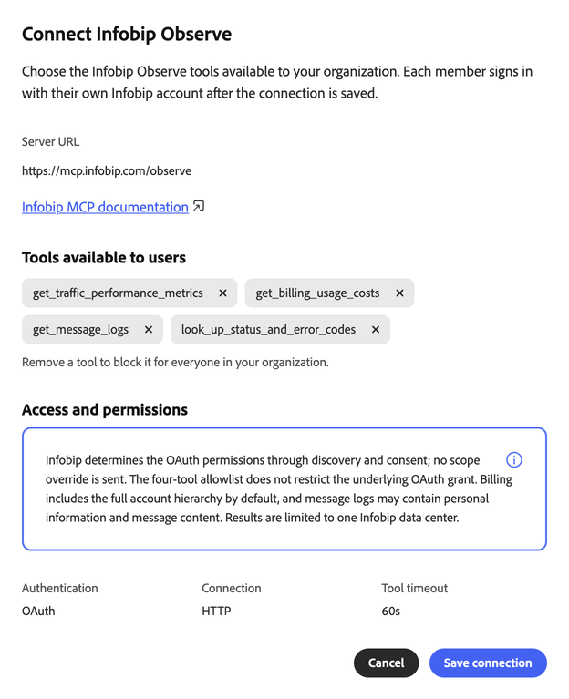

# Infobip Observe 외부 커넥터 {#infobip-observe}

[!DNL Infobip Observe] 외부 커넥터를 사용하여 Adobe CX Enterprise Coworker에서 [!DNL Infobip] 트래픽 및 비용을 검토하십시오. 커넥터를 설정한 후에는 트래픽 지표, 청구 사용, 메시지 로그, 상태 및 오류 코드에 대해 동료에게 문의하십시오. 커넥터가 [!DNL Infobip]에서 호스팅하는 [!DNL Observe] MCP(모델 컨텍스트 프로토콜) 서버입니다.

>[!AVAILABILITY]
>
>[!DNL Infobip Observe] 외부 커넥터가 Beta 버전입니다. 설명서 및 기능은 변경될 수 있습니다.

## 커넥터 구성 {#connector-configuration}

커넥터 구성 프로세스에는 두 개의 별도 부품이 있습니다.

* **조직 설정:** 관리자가 전체 조직에 대해 커넥터를 한 번 구성하고 구성원이 사용할 수 있는 도구를 승인합니다.
* **구성원 로그인:** 각 구성원이 자신의 [!DNL Infobip] 계정으로 로그인합니다. 구성원은 [!DNL Infobip] 계정에 사용 권한이 있는 데이터만 액세스할 수 있습니다.

커넥터에 공유 조직 로그인이 없습니다. 커넥터를 사용하는 모든 멤버는 별도로 로그인합니다. 조직 구성을 저장해도 어떤 구성원도 로그인하지 않거나 [!DNL Infobip] 권한을 추가로 부여하지 않습니다.

## 사전 요구 사항 {#prerequisites}

커넥터는 [!DNL Infobip] [!DNL Observe] MCP 서버에서만 작동합니다. [!DNL Infobip] 메시징, 프로비전 또는 계정 관리 MCP 서버에 연결되지 않습니다.

시작하기 전에 다음을 확인하십시오.

* **동료 액세스:** [!DNL Infobip Observe] 커넥터를 사용할 수 있는 조직에서 조직 커넥터를 관리할 수 있는 권한이 있는 계정입니다.
* **[!DNL Infobip]계정:** 의도한 데이터 센터에서 [!DNL Observe]에 액세스할 수 있는 승인된 [!DNL Infobip] 계정입니다. [!DNL Infobip]이(가) 조기 액세스 기능으로 [!DNL Observe] MCP를 제공합니다. [!DNL Infobip]&#x200B;(으)로 자격 및 계정 적합성을 확인합니다.
* **구성원 ID:** 자신의 [!DNL Infobip] 계정과 의도한 데이터에 액세스할 수 있는 권한이 있는 구성원
* **테스트를 위한 승인된 범위:** 청구, 트래픽 또는 메시지 로그를 쿼리하기 전에 승인된 테스트 범위 및 민감하지 않은 데이터입니다.

커넥터를 테스트하려면 무료 [!DNL Infobip] 평가판 계정에 등록할 수 있습니다. 체험판 계정은 데이터 격리 또는 비용 제로를 보장하지 않습니다. 자세한 내용은 [!DNL Infobip] 설명서에서 [Infobip MCP 서버 사용](https://www.infobip.com/docs/mcp/using-mcp){target="_blank"} 및 [MCP 관찰](https://www.infobip.com/docs/mcp/observe-mcp){target="_blank"}을 참조하십시오.

>[!IMPORTANT]
>
>스크린샷, 채팅 또는 지원 티켓에서 암호, API 키, 토큰, 인증 코드 또는 동의 및 콜백 URL을 절대 공유하지 마십시오.

## 연결 및 로그인 모델 {#connection-model}

동료는 다음 설정을 자동으로 적용합니다. OAuth 앱을 만들거나 앱 자격 증명을 입력하지 않습니다.

| 설정 | 값 |
| --- | --- |
| 서버 URL | `https://mcp.infobip.com/observe` |
| 전송 | 스트리밍 가능 HTTP |
| 인증 서버 검색 | `https://mcp.infobip.com/observe/.well-known/oauth-authorization-server` |
| 로그인 | 각 멤버는 동적 클라이언트 등록을 사용하여 OAuth로 로그인합니다 |
| OAuth 구성 | 자동으로 검색됩니다. 관리자는 클라이언트 ID, 클라이언트 암호, 범위 또는 OAuth 종단점을 입력하지 않습니다. |
| 도구 선택 | 승인된 4개의 도구. 관리자는 선택 항목의 범위를 좁힐 수 있습니다. |

[!DNL Infobip] 검색 및 각 구성원의 동의에 따라 동료가 받는 액세스 권한이 결정됩니다. [!DNL Infobip]은(는) [!DNL Observe] MCP에 대한 `billing:usage:view`, `metrics:manage`, `messages-api:manage` 및 `error-codes:read` 범위를 문서화합니다. 승인하기 전에 동의 화면에서 요청된 액세스 권한을 검토하십시오.

[!DNL Infobip]은(는) 다른 MCP 클라이언트에서 [!DNL Observe] MCP에 대한 API 키 인증도 지원합니다. 동료가 이 커넥터에 대한 API 키를 사용하지 않습니다. 구성원은 OAuth로만 로그인합니다.

## 조직을 위한 커넥터 구성 {#configure-organization}

관리자는 조직의 모든 사용자가 [!DNL Infobip Observe] 커넥터를 사용할 수 있도록 합니다. 조직 페이지의 변경 사항은 조직의 모든 사용자에게 적용됩니다. 구성원은 조직 연결을 구성할 수 없습니다.

1. **[!UICONTROL 사용자 지정]**&#x200B;을 열고 **[!UICONTROL 조직]**&#x200B;을 선택한 다음 **[!UICONTROL 외부 커넥터]**&#x200B;를 선택합니다.

1. **[!UICONTROL Infobip Observe]**&#x200B;를 찾은 다음 **[!UICONTROL 구성]**&#x200B;을 선택합니다.

1. **[!UICONTROL Connect Infobip Observe]** 대화 상자에서 고정 **[!UICONTROL 서버 URL]**, `https://mcp.infobip.com/observe`을(를) 검토하십시오.

   OAuth 클라이언트 ID, 클라이언트 암호 또는 범위를 입력할 필요는 없습니다.

1. **[!UICONTROL 사용자가 사용할 수 있는 도구]**&#x200B;에서 처음에 선택한 4개의 도구를 검토하십시오. 조직의 멤버가 사용하지 않아야 하는 도구를 제거합니다. 하나 이상의 도구가 남아 있어야 합니다.

   자세한 내용은 [사용 가능한 도구](#available-tools)를 참조하세요.

   {width="500" zoomable="yes"}

1. **[!UICONTROL 연결 저장]**&#x200B;을 선택합니다. 그런 다음 구성을 다시 열어 도구 선택이 지속되는지 확인합니다.

저장해도 회원님이나 회원이 [!DNL Infobip]에 로그인되지 않습니다. 연결을 직접 확인하려면 [구성원으로 로그인](#sign-in-as-a-member)에 설명된 대로 로그인하십시오.

4개의 도구를 모두 제거한 후 다시 사용하려면 **[!UICONTROL 모든 도구 복원]**&#x200B;을 선택하십시오. 이 옵션은 승인된 4개의 도구만 복원합니다. Coworker는 [!DNL Infobip]에서 나중에 추가하는 도구를 활성화하지 않습니다. 도구를 선택하지 않은 상태에서는 구성을 저장할 수 없습니다.

### 사용 가능한 도구 {#available-tools}

[!DNL Infobip Observe] 커넥터에서 다음 도구를 제공합니다. [!DNL Infobip]은(는) 각 도구의 제한을 변경할 수 있으므로 사용하기 전에 [!DNL Infobip] 설명서를 확인하십시오.

| 도구 | 용도 | 제한 |
| --- | --- | --- |
| `get_traffic_performance_metrics` | 집계된 트래픽, 게재 및 참여 지표. | 최대 366일 데이터. 시간별 창문은 최대 14일까지, 일일 창문은 최대 93일까지 제공됩니다. 로그인 계정에 대한 데이터를 기본적으로 반환합니다. 하위 계정을 명시적으로 포함합니다. |
| `get_billing_usage_costs` | 송장과 연계된 사용 및 비용. | 현재 및 이전 두 달입니다. 기본적으로 전체 계정 계층 구조를 포함합니다. 한 달 동안의 데이터는 다음 달 5일까지 잠정적으로 유지됩니다. |
| `get_message_logs` | 개별 메시지에 대한 로그입니다. | 지난 48시간 로그에는 수신자 식별자, 개인 정보 및 메시지 콘텐츠가 포함될 수 있습니다. |
| `look_up_status_and_error_codes` | 알려진 상태 및 오류 코드 이름에 대한 설명입니다. | 요청당 최대 50개의 이름. [!DNL Infobip]은(는) 결과에서 알 수 없는 이름을 생략할 수 있습니다. |

결과는 하나의 [!DNL Infobip] 데이터 센터로 제한됩니다. 도구 선택은 Coworker에서 사용할 수 있는 도구 멤버를 제어합니다. 구성원이 로그인 시 부여하는 [!DNL Infobip] 액세스, 계정 계층 구조 또는 [!DNL Infobip]에서 시행하는 사용 권한을 좁히지 않습니다.

>[!IMPORTANT]
>
>메시지 로그에는 수신자 식별자 및 메시지 콘텐츠와 같은 개인 데이터가 포함될 수 있습니다. 청구 정보는 민감하며 기본적으로 전체 계정 계층 구조를 포함합니다. 조직에서 사용을 승인하는 경우에만 이러한 도구를 활성화하십시오. 명시적이고 승인된 계정 필터 및 제한된 쿼리를 사용합니다.

## 멤버로 로그인 {#sign-in-as-a-member}

관리자가 커넥터를 구성한 후 각 구성원은 자신의 [!DNL Infobip] 계정으로 로그인합니다. 사용자의 로그인은 사용자의 것입니다. 다른 구성원은 사용자의 자격 증명을 사용하지 않습니다.

1. **[!UICONTROL 사용자 지정]**&#x200B;을 열고 **[!UICONTROL 사용자]**&#x200B;을 선택한 다음 **[!UICONTROL 외부 커넥터]**&#x200B;를 선택합니다. **[!UICONTROL Infobip Observe]**&#x200B;를 찾습니다.

   카드에 **[!UICONTROL 구성되지 않음]** 및 **[!UICONTROL 아직 사용할 수 없음&rbrace;이 표시되는 경우 관리자가 이를 설정해야 합니다.]** 관리자에게 [커넥터를 구성](#configure-organization)하도록 요청하십시오.

1. **[!UICONTROL 로그인]**&#x200B;을 선택하고 원하는 [!DNL Infobip] 계정을 사용하십시오. SSO(Single Sign-On), MFA(Multi-Factor Authentication) 및 동의 프롬프트를 직접 완료합니다. 승인하기 전에 요청된 액세스, 계정 및 데이터 센터를 검토하십시오.

1. Coworker로 돌아가 커넥터 세부 사항을 엽니다. 관리자가 활성화한 도구를 검토합니다.

   구성원은 도구를 볼 수 있지만 조직 구성을 변경할 수는 없습니다.

1. **[!UICONTROL 연결 테스트]**&#x200B;를 선택하십시오.

   성공적인 테스트에서는 동료가 도구를 연결하고 나열할 수 있음을 확인합니다. 모든 도구가 성공적으로 실행되는지 확인하지는 않습니다.

1. 권한이 있고 관리자가 `look_up_status_and_error_codes` 도구를 사용하도록 설정한 경우 [연결 확인](#check-connection)에서 조회를 실행하십시오.

1. 커넥터에서 [!DNL Infobip] 계정의 연결을 끊으려면 **[!UICONTROL 로그아웃]**&#x200B;을 선택하세요.

   로그아웃해도 [!DNL Infobip]에서 부여한 액세스가 취소되지는 않습니다.

## 연결 확인 {#check-connection}

커넥터가 계정에서 작동하는지 확인하려면 읽기 전용 조회를 실행합니다. 관리자가 `look_up_status_and_error_codes` 도구를 사용하도록 설정했는지 확인하십시오. 그런 다음 채팅을 시작하고 프롬프트를 입력하십시오.

예제 프롬프트:

* &quot;Infobip Observe를 사용하여 상태 코드 NO_ERROR를 조회하고 의미를 설명합니다. 트래픽 지표, 청구 또는 메시지 로그를 쿼리하지 마십시오.&quot;

결과에 오류 메시지 없이 `NO_ERROR`에 대한 설명이 포함되어 있는지 확인하십시오. 조회에 성공해도 트래픽, 청구 또는 메시지 로그 도구가 계정에 대해 작동하는지 확인하지 않습니다. 연결을 테스트하기 위해서만 과금 또는 메시지 로그를 쿼리하지 마십시오.

## 액세스 문제 해결 {#troubleshoot-access}

[!DNL Infobip] 데이터에 액세스할 수 없는 경우 관리자에게 다음 사항을 확인하십시오.

| 문제 | 확인할 사항 |
| --- | --- |
| **[!UICONTROL Infobip Observe]** 커넥터가 없습니다. | 조직에서 커넥터를 사용할 수 있으며 조직 커넥터를 관리할 권한이 있는지 확인하십시오. 필요한 경우 Adobe 담당자에게 문의하십시오. |
| 동의 또는 로그인 실패 | 사용한 [!DNL Infobip] 계정, [!DNL Observe] 권한 및 데이터 센터를 확인하십시오. 도움을 요청할 때 동의 URL, 콜백 URL 또는 인증 코드를 공유하지 마십시오. |
| 로그인은 성공하지만 도구는 실패합니다. | 유효한 [!DNL Infobip] 권한, 로그인한 계정 및 데이터 센터, [!DNL Infobip]이(가) 반환하는 오류를 확인합니다. 로그인에 성공해도 도구가 성공적으로 실행되었는지 확인되지 않습니다. |
| 도구를 사용할 수 없음 | 관리자가 활성화한 도구를 확인합니다. 동료가 새 [!DNL Infobip] 도구를 자동으로 사용하도록 설정하지 않습니다. |
| 구성을 저장할 수 없습니다. | 하나 이상의 도구를 선택한 상태로 유지합니다. 커넥터 제공을 중지하려면 대신 제거합니다. |
| 청구 결과에 예기치 않은 계정이 포함됩니다. | 청구 결과에는 기본적으로 전체 계정 계층 구조가 포함됩니다. 중지한 다음 승인된 계정 필터 및 권한을 검토합니다. |
| 메시지 로그에 중요한 데이터가 표시됨 | 쿼리를 중지하고 나중에 쿼리를 승인되고 민감하지 않은 데이터로 제한합니다. 원시 로그를 채팅 또는 지원 티켓에 붙여넣지 마십시오. |
| 상태 코드 조회가 성공했지만 다른 요청이 실패했습니다. | 실패한 요청을 별도로 조사합니다. 조회가 성공해도 모든 도구 또는 계정이 작동하는지 확인되지는 않습니다. |
