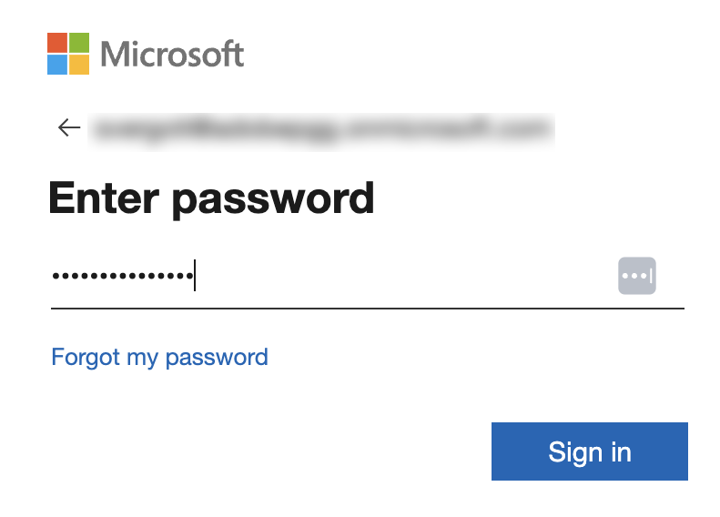

# Microsoft 작업 IQ 외부 커넥터 {#microsoft-work-iq}

[!DNL Microsoft Work IQ] 외부 커넥터를 사용하여 Adobe CX Enterprise Coworker에서 [!DNL Microsoft 365] 데이터로 작업하십시오. 커넥터를 설정한 후에는 Coworker에게 전자 메일, 파일, 모임 및 [!DNL Microsoft Teams]개 메시지를 검색하고 일정 이벤트를 검토하도록 요청하십시오. 커넥터가 [!DNL Microsoft]에서 호스트하는 MCP(모델 컨텍스트 프로토콜) 서버입니다.

>[!AVAILABILITY]
>
>[!DNL Microsoft Work IQ] 외부 커넥터가 Beta 버전입니다. 설명서 및 기능은 변경될 수 있습니다.

## 커넥터 구성 {#connector-configuration}

커넥터 구성 프로세스에는 두 개의 별도 부품이 있습니다.

* **조직 설정:** 관리자가 전체 조직에 대해 커넥터를 한 번 구성합니다. 관리자가 [!DNL Microsoft Entra] 앱을 연결하고 구성원이 사용할 수 있는 도구를 선택합니다.
* **구성원 로그인:** 각 구성원이 자신의 [!DNL Microsoft] 회사 계정으로 로그인합니다. 구성원은 자신의 계정이 액세스할 수 있는 데이터만 액세스할 수 있습니다.

조직 구성을 저장해도 어떤 구성원도 로그인하지 않거나 [!DNL Microsoft 365] 권한을 추가로 부여하지 않습니다. 각 구성원은 개별적으로 로그인해야 합니다.

**[!UICONTROL Microsoft 작업 IQ]** 카드에 공유 OAuth 앱이 언급되어 있으며, 이 앱은 배포에서 앱을 구성할 때만 사용할 수 있습니다. 앱이 이미 제공되었다고 가정하지 마십시오. 이 페이지에서는 [!DNL Microsoft Entra] 앱을 연결하는 방법에 대해 설명합니다.

## 사전 요구 사항 {#prerequisites}

시작하기 전에 다음을 확인하십시오.

* **조직 설정의 경우:** Coworker에서 조직 커넥터를 관리할 수 있는 권한이 있는 계정입니다.
* **[!DNL Microsoft Entra] 앱의 경우:** 웹 앱을 등록하고 관리자 동의를 부여할 수 있는 [!DNL Microsoft Entra] 관리자
* **테넌트에 대해 [!DNL Microsoft] 테넌트의 경우:** 테넌트에 대해 [!DNL Work IQ]을(를) 사용합니다.
* **회원 로그인:** 사용할 데이터에 액세스할 수 있는 자격 있는 [!DNL Microsoft] 회사 계정입니다.

## 조직을 위한 커넥터 구성 {#configure-organization}

관리자는 조직의 모든 사용자가 [!DNL Microsoft Work IQ] 커넥터를 사용할 수 있도록 합니다. 조직 페이지의 변경 사항은 조직의 모든 사용자에게 적용됩니다.

1. **[!UICONTROL 사용자 지정]**&#x200B;을 열고 **[!UICONTROL 조직]**&#x200B;을 선택한 다음 **[!UICONTROL 외부 커넥터]**&#x200B;를 선택합니다. **[!UICONTROL Microsoft 작업 IQ]** 카드에서 **[!UICONTROL 구성]**&#x200B;을 선택합니다.

1. **[!UICONTROL 조직에 대한 Microsoft 작업 IQ 구성]** 대화 상자에서 **[!UICONTROL 서버 URL]**, `https://workiq.svc.cloud.microsoft/mcp`을(를) 검토하십시오. 그런 다음 [!DNL Microsoft Entra] 앱을 준비합니다. [!DNL Microsoft] 요구 사항에 대해 대화 상자에서 **[!UICONTROL Microsoft 설치 지침]**&#x200B;을 선택합니다.

   1. [!DNL Microsoft Entra]에서 웹 앱을 등록하거나 기존 웹 앱을 사용하십시오.
   1. 대화 상자에서 **[!UICONTROL 리디렉션 URL]**&#x200B;을(를) 복사하고 이 정확한 값을 앱에 웹 리디렉션 URL로 등록합니다. 리디렉션 URL은 환경마다 다르므로 항상 대화 상자에서 복사하십시오.
   1. 클라이언트 암호를 만들거나 기존 클라이언트 암호가 여전히 유효한지 확인하십시오. 비밀 ID가 아니라 비밀 값이 필요합니다.
   1. 위임된 `WorkIQAgent.Ask` 권한에 대한 관리자 동의를 부여하고 테넌트에 대해 [!DNL Work IQ]이(가) 활성화되었는지 확인하십시오.

   **[!UICONTROL Microsoft Entra 테넌트 ID]**&#x200B;에서 테넌트 ID를 입력하십시오. [!DNL Microsoft Entra]에서 **[!UICONTROL 개요]** > **[!UICONTROL 디렉터리(테넌트) ID]**&#x200B;에서 이 값을 찾습니다.

   {width="500" zoomable="yes"}

1. **[!UICONTROL 자격 증명을 가져오는 위치]**&#x200B;에서 다음 옵션 중 하나를 선택하십시오.

   * **[!UICONTROL 새로 입력]:** **[!UICONTROL OAuth 앱 클라이언트 ID]**&#x200B;에서 [!DNL Microsoft Entra] 앱의 응용 프로그램(클라이언트) ID를 입력하십시오. **[!UICONTROL OAuth 앱 클라이언트 암호]**&#x200B;에서 암호 값을 입력하십시오. 동료는 비밀 값을 조직 비밀로 저장합니다.
   * **[!UICONTROL 기존 암호 사용]:** **[!UICONTROL 클라이언트 ID를 보유한 암호]** 및 **[!UICONTROL 클라이언트 암호를 보유한 암호]**&#x200B;에서 앱에 대해 저장된 조직 암호를 선택하십시오. 올바른 암호를 사용할 수 없으면 대신 **[!UICONTROL 새로 입력]**&#x200B;을 선택하세요. 테넌트 ID를 별도로 입력합니다.

   테넌트 ID, 클라이언트 ID 및 클라이언트 암호는 모두 동일한 앱과 테넌트에 속해야 합니다. 저장된 암호를 다시 사용하는 경우 클라이언트 암호가 만료되지 않았는지 확인합니다. 이 앱 자격 증명은 구성원이 로그인하는 데 사용하는 [!DNL Microsoft] 암호와 별개입니다.

   {width="500" zoomable="yes"}

1. **[!UICONTROL 사용자가 사용할 수 있는 도구]**&#x200B;에서 조직에 필요한 도구를 선택합니다. 자세한 내용은 [사용 가능한 도구](#available-tools)를 참조하세요. **[!UICONTROL 액세스 및 권한]**&#x200B;을 검토하여 각 사용자가 개별적으로 로그인하는지 확인한 다음 **[!UICONTROL 구성 저장]**&#x200B;을 선택하십시오.

   ![조직 대화 상자에 대해 Microsoft 작업 IQ를 전체 구성합니다. [도구]에서 선택한 읽기 전용 도구는 사용자가 사용할 수 있고, [묻기 도구] 및 [데이터 변경 도구]는 지워져 있으며, 각 사용자는 [액세스] 및 [권한]에서 별도로 알림을 받고 로그인합니다.](./assets/microsoft-work-iq/org-tools.png){zoomable="yes"}

1. 저장된 **[!UICONTROL workiq]** 커넥터 세부 정보를 검토하십시오. 선택적으로 **[!UICONTROL 테스트]**&#x200B;를 선택하여 Coworker가 커넥터 도구를 검색할 수 있는지 확인합니다. 저장한 후 도구를 변경하려면 [도구 선택 변경](#change-tool-selection)을 참조하세요.

   | 설정 | 설명 |
   | --- | --- |
   | **[!UICONTROL Source]** | [!DNL Work IQ] MCP 서버, `https://workiq.svc.cloud.microsoft/mcp`. |
   | **[!UICONTROL 인증]** | 인증 방법, `workiq_login`입니다. |
   | **[!UICONTROL 도구 시간 초과]** | 커넥터에 대한 도구 시간 제한. |
   | **[!UICONTROL Connection]** | 자신의 로그인 상태입니다. |

   {width="500" zoomable="yes"}

커넥터 세부 정보에 대한 **[!UICONTROL 로그인되지 않음]** 상태는 조직이 아니라 사용자 연결을 참조합니다. 커넥터를 직접 사용하려면 **[!UICONTROL 로그인]**&#x200B;을 선택하고 [구성원으로 로그인](#sign-in-as-a-member)의 단계를 따릅니다.

조직에 대한 커넥터 제공을 중지하려면 커넥터 세부 정보 페이지에서 **[!UICONTROL 제거]**&#x200B;를 선택하세요.

### 사용 가능한 도구 {#available-tools}

[!DNL Microsoft Work IQ] 커넥터는 다음 도구를 제공합니다.

| 도구 | 설명 |
| --- | --- |
| `search_paths` | 사용 가능한 [!DNL Microsoft 365] 기능 및 해결 방법을 찾습니다. |
| `get_schema` | 지원되는 요청이 허용하거나 반환하는 필드를 확인합니다. |
| `list_agents` | [!DNL Microsoft 365 Copilot] 에이전트를 실행하지 않고 계정에 사용할 수 있습니다. |
| `fetch` | 메시지, 이벤트, 파일 및 직원과 같이 계정에서 액세스할 수 있는 [!DNL Microsoft 365]개 항목을 읽습니다. 데이터를 변경하지 않습니다. |
| `call_function` | 달력 보기 또는 최근 변경 사항과 같이 계정이 액세스할 수 있는 데이터의 결과를 계산합니다. 데이터를 변경하지 않습니다. |
| `retrieve` | 각 소스에 대한 링크를 사용하여 이메일, 파일, 모임, [!DNL Microsoft Teams]개의 메시지, 사람 및 연결된 소스를 검색합니다. |
| `fetch_blob` | 문서, 이미지 또는 프로필 사진 등의 파일을 최대 4MB까지 다운로드합니다. 데이터를 변경하지 않습니다. |
| `ask` | 전자 메일, 모임, 파일 및 기타 [!DNL Microsoft 365] 데이터에 대해 [!DNL Microsoft 365 Copilot] 또는 해당 에이전트 중 한 명에게 문의하십시오. |
| `delete_entity` | 메시지 또는 이벤트와 같은 [!DNL Microsoft 365] 항목을 삭제합니다. 데이터를 변경합니다. |
| `do_action` | 메일을 보내거나 항목을 이동하는 등의 [!DNL Microsoft 365] 작업을 실행합니다. 데이터를 변경합니다. |
| `create_entity` | 이벤트 또는 메시지 초안과 같은 [!DNL Microsoft 365] 항목을 만듭니다. 데이터를 변경합니다. |
| `update_entity` | 이벤트나 연락처와 같은 기존 [!DNL Microsoft 365] 항목을 변경합니다. 데이터를 변경합니다. |

>[!IMPORTANT]
>
>`delete_entity`, `do_action`, `create_entity` 및 `update_entity` 도구는 [!DNL Microsoft 365]에서 데이터를 변경합니다. 이러한 도구를 주의 깊게 검토하고 조직 구성원이 사용할 도구만 선택합니다.

서버가 추가하는 도구는 나중에 선택할 때까지 중지됩니다.

### 도구 선택 사항 변경 {#change-tool-selection}

저장한 후 구성원이 사용할 수 있는 도구를 변경하려면 커넥터 세부 정보 페이지의 **[!UICONTROL 도구]** 섹션을 사용하십시오.

1. 개별 도구를 선택하거나 지우거나 **[!UICONTROL 모두 선택]** 또는 **[!UICONTROL 지우기]**&#x200B;를 사용하십시오.

1. **[!UICONTROL 도구 선택 저장]**&#x200B;을 선택합니다.

>[!CAUTION]
>
>**[!UICONTROL 모든 도구 표시]**&#x200B;를 선택하면 현재 선택 내용이 지워집니다. 그러면 새 선택 항목을 저장할 때까지 정책에서 제외하지 않는 모든 도구를 멤버가 사용할 수 있습니다. 도구 목록을 보기 위해서만 **[!UICONTROL 모든 도구 표시]**&#x200B;를 선택하지 마십시오.

## 멤버로 로그인 {#sign-in-as-a-member}

관리자가 커넥터를 구성한 후 각 구성원은 각자의 [!DNL Microsoft] 작업 계정으로 로그인합니다. 로그인하는 데 앱 클라이언트 암호가 필요하지 않습니다.

1. **[!UICONTROL 사용자 지정]**&#x200B;을 열고 **[!UICONTROL 사용자]**&#x200B;을 선택한 다음 **[!UICONTROL 외부 커넥터]**&#x200B;를 선택합니다.

1. **[!UICONTROL Microsoft 작업 IQ]** 카드에서 **[!UICONTROL 로그인]**&#x200B;을 선택합니다.

   카드에 **[!UICONTROL 구성되지 않음]**&#x200B;이 표시되거나 커넥터를 사용할 수 없는 경우 관리자에게 [커넥터를 구성](#configure-organization)하도록 요청하십시오.

1. [!DNL Microsoft] **[!UICONTROL 계정 선택]** 화면에서 조직의 작업 계정을 선택하거나 **[!UICONTROL 다른 계정 사용]**&#x200B;을 선택합니다.

   브라우저가 다른 테넌트의 계정을 포함하여 여러 계정을 기억할 수 있습니다. 이미 로그인한 계정이 항상 올바른 계정은 아닙니다. 필요한 [!DNL Microsoft 365] 액세스 권한이 있는 계정을 선택하십시오.

   {width="400" zoomable="yes"}

1. 암호, SSO(Single Sign-On), 암호 없는 로그인, MFA(Multi-Factor Authentication) 또는 기타 인증 등 계정의 로그인 단계를 완료합니다.

   조직에서 승인하는 로그인 흐름에만 [!DNL Microsoft] 자격 증명을 입력하십시오. 커넥터의 OAuth 앱 필드에 이를 입력하지 마십시오.

   {width="400" zoomable="yes"}

1. [!DNL Microsoft]이(가) 동의를 요청하면 요청을 검토하십시오.

   >[!IMPORTANT]
   >
   >앱을 인식하고 조직에서 요청된 액세스를 승인하는 경우에만 계속합니다.

1. [!DNL Microsoft]이(가) Coworker로 돌아간 후 **[!UICONTROL workiq]** 커넥터 세부 정보를 엽니다. 커넥터에 **[!UICONTROL 연결됨]** 및 **[!UICONTROL 로그인됨]**&#x200B;이 표시되는지 확인하십시오.

   {width="700" zoomable="yes"}

1. 사용할 수 있는 도구를 보려면 **[!UICONTROL 관리자가 사용하도록 설정한 도구]**&#x200B;를 검토하세요.

커넥터 세부 정보에서 다음 작업을 수행할 수도 있습니다.

* **[!UICONTROL 테스트]:** Coworker에서 커넥터 도구를 검색할 수 있는지 확인합니다.
* **[!UICONTROL 로그아웃]:** 커넥터에서 [!DNL Microsoft] 계정의 연결을 끊습니다.

또한 커넥터 세부 정보에 **[!UICONTROL 도구 시간 초과]** 설정 및 **[!UICONTROL 새로 고침]** 컨트롤이 표시됩니다.

**[!UICONTROL 연결됨]** 상태로는 모든 [!DNL Microsoft 365] 리소스에 액세스할 수 있는지, 모든 도구가 성공적으로 실행되는지 확인할 수 없습니다. 액세스 권한을 확인하려면 [Microsoft 365 액세스 권한을 확인](#check-access)하세요.

## Microsoft 365 액세스 확인 {#check-access}

커넥터가 데이터를 읽을 수 있는지 확인하려면 채팅을 시작하고 읽기 전용 프롬프트를 입력하십시오.

예제 프롬프트:

* &quot;내일 내 모임을 찾아 소스에 대한 링크를 포함하십시오. 아무 것도 만들거나, 업데이트하거나, 보내거나, 삭제하지 마십시오.&quot;

이 프롬프트가 작동하려면 관리자가 일정 데이터를 읽을 수 있는 도구를 활성화해야 하며 계정에 데이터에 대한 액세스 권한이 있어야 합니다.

## 액세스 문제 해결 {#troubleshoot-access}

로그인 또는 액세스가 실패할 경우 관리자에게 다음 사항을 확인하십시오.

| 영역 | 확인할 사항 |
| --- | --- |
| [!DNL Microsoft] 계정 | 의도한 테넌트에 대해 올바른 작업 계정으로 로그인했습니다. |
| [!DNL Work IQ] 사용 가능 | [!DNL Microsoft] 테넌트에 대해 [!DNL Work IQ]을(를) 사용할 수 있습니다. |
| 리디렉션 URI | [!DNL Microsoft Entra] 앱에는 웹 리디렉션 URI로 등록된 대화 상자의 정확한 리디렉션 URL이 있습니다. |
| 관리자 동의 | 관리자가 위임된 `WorkIQAgent.Ask` 권한에 대한 관리자 동의를 부여했습니다. |
| 클라이언트 암호 | 클라이언트 암호가 만료되지 않았으며 커넥터가 암호 ID가 아닌 암호 값을 사용합니다. |
| 저장된 비밀 | 선택한 두 조직 암호가 의도한 [!DNL Microsoft Entra] 앱에 속합니다. |
| 도구 선택 | 하나의 도구만 실패하는 경우 관리자가 해당 도구를 활성화했습니다. |
| [!DNL Microsoft 365] 권한 | 요청한 데이터에 액세스할 수 있는 권한이 계정에 있습니다. |
