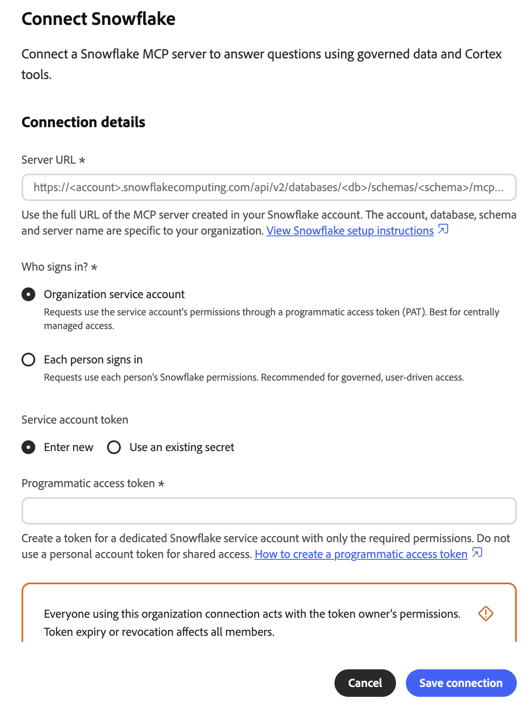
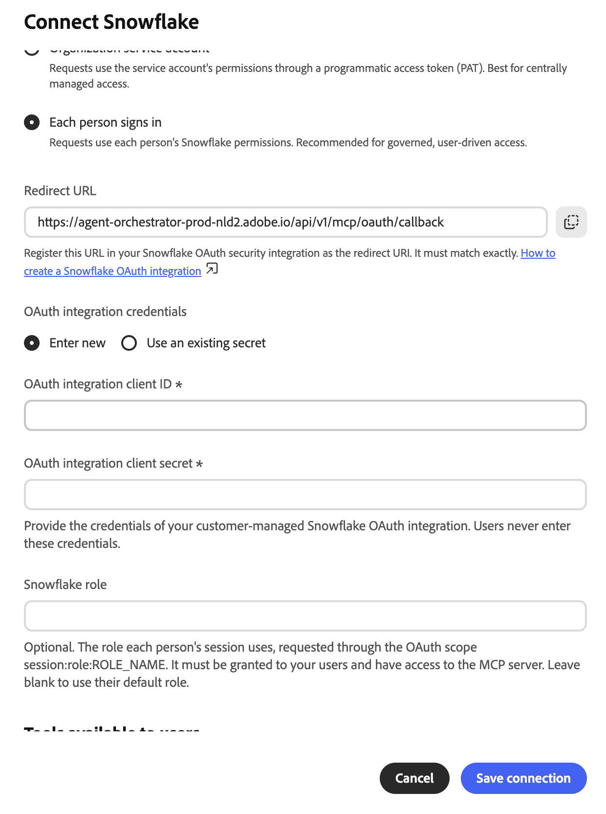
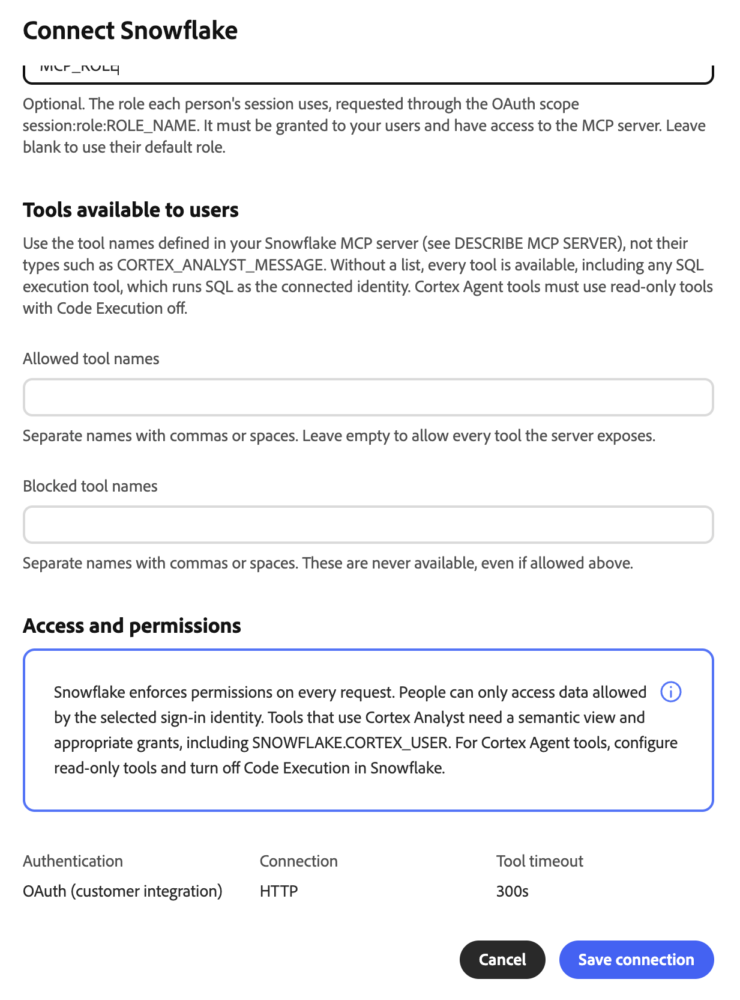
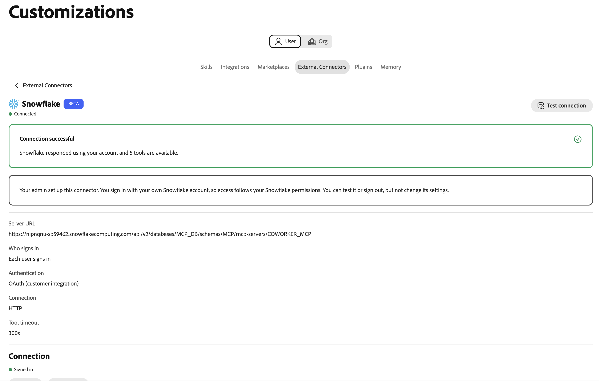

# Snowflake Cortex AI 외부 커넥터 {#snowflake}

[!DNL Snowflake Cortex AI] 외부 커넥터를 사용하여 Adobe CX Enterprise Coworker에서 [!DNL Snowflake] 데이터에 대해 일반 언어로 질문할 수 있습니다. 커넥터가 Coworker를 [!DNL Snowflake] 계정의 [!DNL Snowflake] 관리 MCP(Model Context Protocol) 서버에 연결합니다. 그러면 Coworker는 [!DNL Cortex Analyst], [!DNL Cortex Search] 및 SQL 도구와 같이 서버가 표시하는 도구를 사용할 수 있습니다.

>[!AVAILABILITY]
>
>[!DNL Snowflake Cortex AI] 외부 커넥터가 Beta 버전입니다. 설명서 및 기능은 변경될 수 있습니다.

## 커넥터 구성 {#connector-configuration}

커넥터 구성 프로세스에는 두 개의 별도 부품이 있습니다.

* **조직 설정:** 관리자가 Coworker를 기존 [!DNL Snowflake] MCP 서버에 연결하고 로그인 방법을 선택하고 구성원이 사용할 수 있는 도구를 선택합니다.
* **구성원 액세스:** 구성원은 로그인 옵션에 따라 공유 조직 ID 또는 자신의 [!DNL Snowflake] ID로 연결을 사용합니다.

관리자는 다음 로그인 옵션 중 하나를 선택합니다.

| 옵션 | 관리자가 제공하는 사항 | 액세스 작동 방식 |
| --- | --- | --- |
| **[!UICONTROL 조직 서비스 계정]** | 서비스 계정에 대한 [!DNL Snowflake] 프로그래밍 방식 액세스 토큰(PAT)입니다. | 모든 구성원은 서비스 계정의 권한을 사용합니다. 토큰 만료 또는 취소는 모든 구성원에 영향을 줍니다. |
| **[!UICONTROL 각 사용자가 로그인함]** | [!DNL Snowflake] OAuth 통합의 클라이언트 ID 및 클라이언트 암호와 선택적 [!DNL Snowflake] 역할입니다. | 각 구성원은 자신의 [!DNL Snowflake] ID로 로그인하며 액세스는 해당 [!DNL Snowflake] 권한을 따릅니다. |

두 옵션 모두 선택한 ID에 없는 [!DNL Snowflake] 권한을 부여하지 않습니다. [!DNL Snowflake]은(는) 모든 요청에 권한을 적용합니다.

## 사전 요구 사항 {#prerequisites}

동료가 기존 [!DNL Snowflake] MCP 서버에 연결합니다. 서버나 해당 도구를 만들지 않습니다. 시작하기 전에 다음을 확인하십시오.

* **조직 설정의 경우:** Coworker에서 조직 커넥터를 관리할 수 있는 권한이 있는 계정입니다.
* **[!DNL Snowflake] MCP 서버의 경우:** 데이터베이스, 스키마 및 서버 이름을 포함한 서버의 전체 HTTPS URL입니다.
* **서비스 계정 옵션의 경우:** 전용 서비스 계정의 PAT입니다. 서비스 계정 역할에는 MCP 서버 및 해당 도구에 필요한 권한만 있어야 합니다.
* **사용자별 로그인 옵션:** 클라이언트 ID 및 클라이언트 암호와 [!DNL Snowflake] OAuth 통합. 또한 Coworker 리디렉션 URL을 등록하고 통합을 구성할 수 있는 [!DNL Snowflake] 관리자가 필요합니다.

>[!IMPORTANT]
>
>스크린샷, 채팅 또는 지원 티켓에서 PAT, OAuth 클라이언트 암호 또는 기타 자격 증명을 공유하지 마십시오. 조직 비밀과 가장 낮은 권한을 가진 [!DNL Snowflake] ID를 사용하십시오.

### Snowflake MCP 서버 구성 {#configure-snowflake-mcp-server}

커넥터를 구성하기 전에 [!DNL Snowflake] 관리자가 [!DNL Snowflake]에서 다음 작업을 완료해야 합니다.

1. MCP 서버를 만들고 노출된 도구를 정의합니다.
1. MCP 서버, 해당 도구 및 기본 개체에 필요한 역할 액세스 권한을 부여합니다.

   MCP 서버에 대한 액세스는 모든 도구 또는 개체에 대한 액세스를 자동으로 부여하지 않습니다.

1. 사용할 로그인 옵션에 대한 인증을 설정합니다.

   * 서비스 계정 옵션의 경우 서비스 계정에 대한 PAT를 만듭니다.
   * 사용자별 로그인 옵션의 경우 새로 고침 토큰을 발급하는 OAuth 통합을 만듭니다.

지침은 다음 [!DNL Snowflake] 설명서를 참조하십시오.

* [Snowflake 관리 MCP 서버](https://docs.snowflake.com/en/user-guide/snowflake-cortex/cortex-agents-mcp){target="_blank"}
* [MCP 서버 만들기](https://docs.snowflake.com/en/sql-reference/sql/create-mcp-server){target="_blank"}
* [액세스 제어 개요](https://docs.snowflake.com/en/user-guide/security-access-control-overview){target="_blank"}
* [사용자 지정 클라이언트에 대한 Snowflake OAuth 구성](https://docs.snowflake.com/en/user-guide/oauth-custom){target="_blank"}
* [보안 통합 만들기(Snowflake OAuth)](https://docs.snowflake.com/en/sql-reference/sql/create-security-integration-oauth-snowflake){target="_blank"}
* [인증에 프로그래밍 방식 액세스 토큰 사용](https://docs.snowflake.com/en/user-guide/programmatic-access-tokens){target="_blank"}

## 조직을 위한 커넥터 구성 {#configure-organization}

관리자는 조직의 모든 사용자가 [!DNL Snowflake Cortex AI] 커넥터를 사용할 수 있도록 합니다. 조직 페이지의 변경 사항은 조직의 모든 사용자에게 적용됩니다.

1. **[!UICONTROL 사용자 지정]**&#x200B;을 열고 **[!UICONTROL 조직]**&#x200B;을 선택한 다음 **[!UICONTROL 외부 커넥터]**&#x200B;를 선택합니다. **[!UICONTROL Snowflake Cortex AI]** 카드에서 **[!UICONTROL 구성]**&#x200B;을 선택합니다.

1. **[!UICONTROL Snowflake Cortex AI 연결]** 대화 상자에서 **[!UICONTROL 서버 URL]**&#x200B;에 [!DNL Snowflake] MCP 서버의 전체 URL을 입력합니다. URL은 HTTPS를 사용하고 다음 패턴을 따라야 합니다.

   ```text
   https://<account-host>/api/v2/databases/<database>/schemas/<schema>/mcp-servers/<server-name>
   ```

   [!DNL Snowflake] 계정 및 MCP 서버에 정확한 URL을 사용하십시오. 계정 호스트 이름에는 인코딩된 밑줄(`%5F`)을 포함하는 밑줄을 포함해서는 안 됩니다. URL에 자격 증명을 포함하지 마십시오. Coworker는 저장하기 전에 HTTPS 체계, 호스트 및 경로를 확인합니다.

1. **[!UICONTROL 누가 로그인합니까?]**&#x200B;에서 로그인 옵션을 선택한 다음 설정을 완료합니다.

   * **[!UICONTROL 조직 서비스 계정]:** 요청은 PAT(프로그래밍 방식 액세스 토큰)를 통해 서비스 계정의 권한을 사용합니다. 중앙에서 관리되는 액세스에 이 옵션을 사용합니다. 개인 계정이 아닌 범위가 좁은 역할의 전용 서비스 계정을 사용합니다.

     {width="500" zoomable="yes"}

     | 설정 | 설명 |
     | --- | --- |
     | **[!UICONTROL 서비스 계정 토큰]** | 토큰의 출처를 선택합니다. PAT를 입력하려면 **[!UICONTROL 새로 입력]**&#x200B;을 선택하고 토큰이 이미 포함된 조직 암호를 다시 사용하려면 **[!UICONTROL 기존 암호를 사용]**&#x200B;을 선택하십시오. 기존 암호에는 원시 토큰뿐만 아니라 `Authorization` 헤더에 대한 전체 값이 포함되어야 합니다. |
     | **[!UICONTROL 프로그래밍 방식 액세스 토큰]** | **[!UICONTROL 새로 입력]**&#x200B;을 선택할 때 필요합니다. 필요한 권한만 있는 전용 [!DNL Snowflake] 서비스 계정에 대한 토큰을 만드십시오. 지침이 필요하면 대화 상자에서 **[!UICONTROL 프로그래밍 방식의 액세스 토큰을 만드는 방법]**&#x200B;을 선택하십시오. 동료는 토큰을 조직 비밀로 저장합니다. |

     >[!IMPORTANT]
     >
     >이 연결을 사용하는 모든 사람은 토큰 소유자의 권한으로 작동합니다. 토큰이 만료되거나 취소되면 모든 멤버에 대한 연결이 중지됩니다.

     PAT를 만들고 사용하는 경우 [!DNL Snowflake] 네트워크 및 인증 정책이 적용될 수 있습니다. 토큰 만들기 또는 인증이 차단된 경우 [!DNL Snowflake] 관리자에게 이러한 정책을 확인하도록 요청하십시오.

   * **[!UICONTROL 각 사용자가 로그인함]:** 요청은 각 사용자의 [!DNL Snowflake] 권한을 사용합니다. 관리되는 사용자 기반 액세스에는 이 옵션을 사용합니다.

     {width="500" zoomable="yes"}

     | 설정 | 설명 |
     | --- | --- |
     | **[!UICONTROL 리디렉션 URL]** | 읽기 전용. 이 URL을 복사하여 [!DNL Snowflake] OAuth 보안 통합에 리디렉션 URI로 등록합니다. 값은 정확히 일치해야 합니다. 지침은 대화 상자에서 **[!UICONTROL Snowflake OAuth 통합을 만드는 방법]**&#x200B;을 선택하십시오. 리디렉션 URL은 환경마다 다르므로 항상 대화 상자에서 복사하십시오. |
     | **[!UICONTROL OAuth 통합 자격 증명]** | 자격 증명의 출처를 선택합니다. **[!UICONTROL 새로 입력]**&#x200B;을 선택하여 클라이언트 ID와 클라이언트 암호를 입력하거나 **[!UICONTROL 기존 암호를 사용]**&#x200B;하여 암호를 포함하는 조직 암호를 선택하십시오. |
     | **[!UICONTROL OAuth 통합 클라이언트 ID]** | **[!UICONTROL 새로 입력]**&#x200B;을 선택할 때 필요합니다. 고객 관리 [!DNL Snowflake] OAuth 통합의 클라이언트 ID. |
     | **[!UICONTROL OAuth 통합 클라이언트 암호]** | **[!UICONTROL 새로 입력]**&#x200B;을 선택할 때 필요합니다. 동일한 OAuth 통합의 클라이언트 암호입니다. 구성원은 이러한 자격 증명을 입력하지 않습니다. |
     | **[!UICONTROL Snowflake 역할]** | 선택 사항입니다. OAuth 범위 `session:role:ROLE_NAME`을(를) 통해 요청된 각 세션에서 사용하는 역할입니다. 역할은 회원에게 부여되어야 하며 MCP 서버에 대한 액세스 권한이 있어야 합니다. 각 구성원의 기본 역할을 사용하려면 필드를 비워 둡니다. |

     동료는 계정 URL에서 OAuth 끝점을 파생하고 새로 고침 토큰을 요청합니다. 새로 고침 토큰을 발급하도록 OAuth 통합을 구성합니다. 요청된 범위만 통합 구성을 재정의하지 않습니다.

     Coworker는 역할 이름을 대문자로 변환합니다. 따옴표 붙은 소문자로 만든 역할은 사용할 수 없습니다. OAuth 통합이 역할을 차단하거나 구성원에게 역할이 없는 경우 로그인 또는 액세스가 실패할 수 있습니다.

1. **[!UICONTROL 사용자가 사용할 수 있는 도구]**&#x200B;에서 구성원이 사용할 수 있는 도구를 선택합니다. 각 [!DNL Snowflake] MCP 서버는 자체 도구를 정의하므로 대화 상자에 고정 목록이 표시되지 않습니다. `CORTEX_ANALYST_MESSAGE`과(와) 같은 도구 형식이 아니라 MCP 서버에 정의된 대로 도구 이름을 입력하십시오. 도구 이름을 보려면 [!DNL Snowflake]에서 `DESCRIBE MCP SERVER`을(를) 실행하십시오.

   {width="500" zoomable="yes"}

   | 설정 | 설명 |
   | --- | --- |
   | **[!UICONTROL 허용된 도구 이름]** | 구성원이 사용할 수 있는 도구입니다. 이름은 쉼표 또는 공백으로 구분하십시오. 차단된 도구를 제외하고 서버가 노출하는 모든 도구를 허용하려면 필드를 비워 둡니다. |
   | **[!UICONTROL 차단된 도구 이름]** | 구성원이 사용할 수 없는 도구입니다. 이름은 쉼표 또는 공백으로 구분하십시오. 차단된 도구는 허용하더라도 사용할 수 없습니다. |

   >[!IMPORTANT]
   >
   >**[!UICONTROL 허용된 도구 이름]**&#x200B;을 비워 두면 구성원이 SQL 실행 도구를 포함한 모든 도구를 사용할 수 있습니다. SQL 실행 도구는 SQL을 연결된 ID로 실행합니다. 서버에서 도구 정의를 검토하고 조직에 필요한 도구만 허용합니다.

   도구 설명은 [!DNL Snowflake] 권한 또는 기타 액세스 컨트롤의 대체가 아닙니다. [!DNL Cortex Analyst] 도구의 경우 의미 체계 보기 및 `SNOWFLAKE.CORTEX_USER` 데이터베이스 역할을 포함한 필수 부여를 설정합니다. [!DNL Cortex Agent] 도구의 경우 읽기 전용 도구를 구성하고 [!DNL Snowflake]에서 코드 실행을 끕니다. 구성원은 도구 선택을 변경할 수 없습니다.

1. **[!UICONTROL 액세스 및 권한]**&#x200B;을 검토한 다음 **[!UICONTROL 연결 저장]**&#x200B;을 선택하십시오. **[!UICONTROL Snowflake Cortex AI]** 카드에 **[!UICONTROL 저장된 구성]**&#x200B;이 표시됩니다.

   서버 URL, 인증 유형 및 도구 정책을 검토하려면 **[!UICONTROL 구성 보기]**&#x200B;를 선택하십시오. 그런 다음 **[!UICONTROL 연결 테스트]**&#x200B;를 선택하여 액세스를 확인하고 서버 도구를 검색합니다.

   새 [!DNL Snowflake] 연결에서 300초 도구 시간 제한을 사용합니다. 저장된 시간 제한이 없는 이전 연결은 기본값 60초를 사용할 수 있습니다. 기존 연결에 대해 표시된 시간 제한을 확인합니다.

테스트가 성공해도 모든 구성원이 모든 도구 또는 [!DNL Snowflake] 개체를 사용할 수 있는지 확인되지 않습니다.

## 커넥터를 멤버로 사용 {#use-as-member}

관리자가 커넥터를 구성한 후 자신의 **[!UICONTROL 사용자 지정]** 보기에서 엽니다.

1. **[!UICONTROL 사용자 지정]**&#x200B;을 열고 **[!UICONTROL 사용자]**&#x200B;을 선택한 다음 **[!UICONTROL 외부 커넥터]**&#x200B;를 선택합니다.

   **[!UICONTROL Snowflake Cortex AI]** 카드에 **[!UICONTROL 구성되지 않음]**&#x200B;이 표시되면 관리자에게 [커넥터를 구성](#configure-organization)하도록 요청하십시오.

1. **[!UICONTROL Snowflake Cortex AI]**&#x200B;를 엽니다. 구성원에 대한 커넥터 세부 사항은 읽기 전용입니다. 서버 URL, 자격 증명 또는 도구 선택을 변경할 수 없습니다.

1. 연결이 조직 서비스 계정을 사용하는 경우 요청은 조직의 ID를 사용합니다. 로그인할 필요가 없습니다. 절대 PAT를 입력하거나 공유하지 마십시오.

1. 연결에 사용자별 로그인을 사용하는 경우 로그인을 시작하고 원하는 [!DNL Snowflake] 계정으로 인증합니다. 필요한 SSO(Single Sign-On) 또는 MFA(Multi-Factor Authentication) 단계를 완료합니다. 요청한 조직, 응용 프로그램 및 역할(있는 경우)을 확인합니다.

1. 필요한 경우 **[!UICONTROL 연결 테스트]**&#x200B;를 선택하십시오. 테스트가 성공하면 **[!UICONTROL 연결 성공]** 및 사용 가능한 도구 수가 표시됩니다.

   {width="700" zoomable="yes"}

   테스트가 성공하기 전에 관리자가 허용한 도구 이름만 세부 정보에 표시하거나 테스트를 실행하라는 메시지가 표시될 수 있습니다. 테스트가 끝나면 각 도구가 설명과 함께 표시됩니다.

   {width="700" zoomable="yes"}

예제의 도구는 [!DNL Snowflake] MCP 서버 하나로 정의됩니다. 표시되는 도구는 서버와 관리자의 도구 선택에 따라 다릅니다.

연결의 인증 세부 정보는 PAT, 컴퓨터 OAuth 또는 사람당 OAuth 사용 여부를 보여 줍니다. [!DNL Snowflake] 계정의 연결을 끊으려면 **[!UICONTROL 로그아웃]**&#x200B;을 선택하세요.

**[!UICONTROL 연결됨]** 상태는 특정 도구 또는 데이터 개체에 대한 액세스를 보장하지 않습니다. [!DNL Snowflake]개의 권한, 정책 및 선택한 역할이 계속 적용됩니다.

## 액세스 문제 해결 {#troubleshoot-access}

설정, 로그인 또는 액세스가 실패할 경우 관리자에게 다음 사항을 확인하십시오.

| 문제 | 확인할 사항 |
| --- | --- |
| 서버 URL이 거부되었습니다. | URL은 HTTPS와 전체 `/api/v2/databases/<database>/schemas/<schema>/mcp-servers/<server-name>` 경로를 사용합니다. 계정 호스트 이름에는 밑줄이 없고 URL에는 자격 증명이 없습니다. |
| PAT를 만들거나 사용할 수 없습니다. | 네트워크 정책, 인증 정책, 토큰 만료 및 서비스 계정의 역할입니다. 기존 암호를 사용하는 경우 암호에 전체 `Authorization` 헤더 값이 포함되어 있는지 확인하십시오. |
| OAuth 리디렉션 URL이 일치하지 않음 | [!DNL Snowflake] OAuth 통합에 동일한 Coworker 환경의 정확한 리디렉션 URL이 있습니다. |
| 로그인은 성공하지만 요청은 실패함 | 역할은 멤버에게 부여되며 OAuth 통합에 의해 허용됩니다. 통합에서 새로 고침 토큰이 문제가 되고 클라이언트 ID와 암호가 의도한 통합에 속합니다. |
| 도구가 없거나 거부되었습니다. | **[!UICONTROL 허용되는 도구 이름]** 및 **[!UICONTROL 차단된 도구 이름]** 설정, MCP 서버의 도구 사용 가능 여부 및 [!DNL Snowflake]에서 서버, 도구 및 기본 개체에 대해 권한을 부여합니다. |
| 도구 호출 시간 초과 | 커넥터 세부 정보에 대한 **[!UICONTROL 도구 시간 초과]**&#x200B;입니다. 새 연결은 300초를 사용합니다. 저장된 시간 제한이 없는 이전 연결은 60초를 사용할 수 있습니다. |
